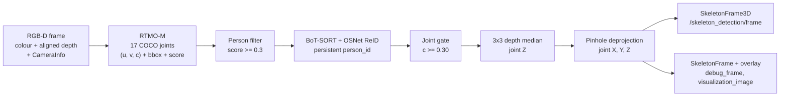

# Skeleton Detection

ROS 2 Humble node (`iot_node`, node name `rtmo_node`) for real-time
multi-person skeletons on an NVIDIA DGX Spark. It runs RTMO-M 2D pose,
BoT-SORT + OSNet ReID tracking, and computes per-joint 3D positions from an
aligned RGB-D stream.

| Topic | Type | Role |
|---|---|---|
| `/skeleton_detection/frame` | `patrolknight_msgs/SkeletonFrame3D` | official: tracked persons, 17 joints × `[X, Y, Z, conf]` in the camera optical frame |
| `/skeleton_detection/debug_frame` | `patrolknight_msgs/SkeletonFrame` | legacy V2.0 message (UV joints, bbox, person position) |
| `/skeleton_detection/visualization_image` | `sensor_msgs/Image` | 2D overlay |

## Pipeline



RTMO and tracking run once per frame; all outputs reuse that result.

- **RTMO-M.** One bottom-up network pass returns, per person, a score $`s`$,
  a box, and 17 COCO joints with pixel position $`(u_i, v_i)`$ and confidence
  $`c_i`$. No separate person detector.
- **Person filter.** Detections with $`s < 0.3`$ (`person_score_threshold`)
  are dropped before tracking and never published.
- **BoT-SORT + ReID.** A Kalman filter predicts each track's box; tracks and
  detections are matched by the cheaper of IoU distance and OSNet appearance
  distance, solved as an assignment problem:

  ```math
  d_{\mathrm{IoU}} = 1 - \mathrm{IoU},\qquad
  c = \min\left(d_{\mathrm{IoU}},\ d_{\mathrm{emb}}\right),\quad
  d_{\mathrm{emb}} := 1 \text{ if } d_{\mathrm{emb}} > 0.25 \text{ or } d_{\mathrm{IoU}} > 0.7
  ```

  ReID features are extracted every second frame and smoothed per track as
  $`f \leftarrow \mathrm{normalize}(0.9 f + 0.1 f_{\mathrm{new}})`$. A lost
  track survives $`\lfloor 55/30 \cdot 90 \rfloor = 165`$ processed frames.
  Only tracked persons ($`\texttt{person\_id} \ge 0`$) reach the official topic.
- **Joint gate.** Only joints with $`c_i \ge 0.30`$
  (`depth_keypoint_score_threshold`) read depth; the others get NaN XYZ but
  keep their confidence.
- **Depth.** The 3×3 aligned-depth patch around the rounded joint pixel is
  scaled to meters, invalid samples (0, NaN, ±inf) are removed, and the
  median of the rest is the joint's Z:

  ```math
  Z_i = \operatorname{median}\{\, z \in P_{3\times3}(u_i, v_i) : z \text{ finite},\ z > 0 \,\}
  ```

- **Deprojection.** The joint's own pixel is lifted into the camera optical
  frame (X right, Y down, Z forward, meters) with the colour intrinsics:

  ```math
  X_i = \frac{(u_i - c_x)\,Z_i}{f_x},\qquad Y_i = \frac{(v_i - c_y)\,Z_i}{f_y}
  ```

  and packed as `joints_xyzc[4i : 4i+4] = [X_i, Y_i, Z_i, c_i]` for COCO
  joint $`i = 0..16`$ (68 floats per person).

## Launch

```bash
docker compose up
```

Start the camera separately through the IoT stack so it publishes /camera/camera/rgbd.

## Documentation

- [Skeleton Detection V2.1](docs/Skeleton_Detection_V2.1.md): current
  pipeline, message layout, build and launch details, troubleshooting,
  validation
- [Skeleton Detection V2.0](docs/Skeleton_Detection_V2.0.md): baseline
  pipeline and operations reference
