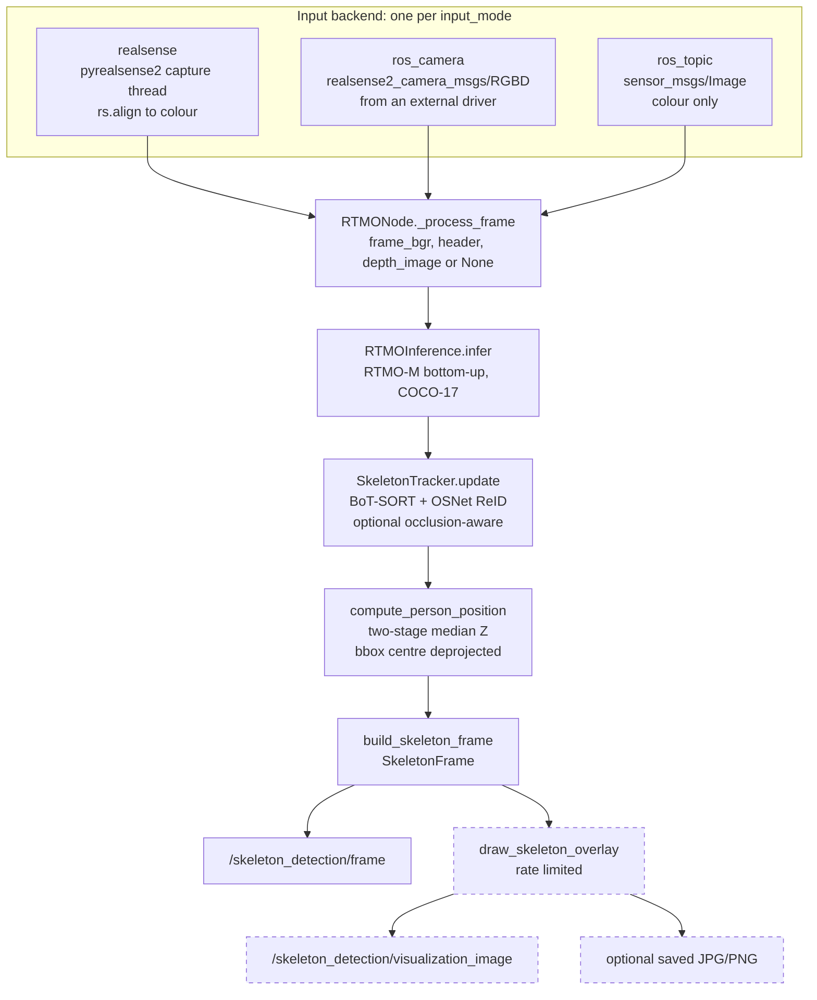

# Skeleton Detection V2.0

Reference for the V2.0 baseline: what one frame goes through, what the node
publishes, and how to build, run and debug it.

| | |
|---|---|
| Baseline commit | `b845fdd` (`main`). The IoT repo pins its `modules/skeleton_detection` submodule to this commit, and its `iot-skeleton` image is built from it |
| Executable / node name | `iot_node` / `rtmo_node` (one ROS 2 Humble node, one Python process) |
| Output | `patrolknight_msgs/msg/SkeletonFrame` on `/skeleton_detection/frame`; optional `sensor_msgs/msg/Image` overlay |
| Successor | [Skeleton Detection V2.1](Skeleton_Detection_V2.1.md) keeps this pipeline and moves this message to `/skeleton_detection/debug_frame` |

Most of the operational material in [section 6](#6-operations) applies to V2.1
too, because the image, launch file, input modes and tracking did not change.
Where V2.1 differs, the V2.1 guide says so.

## Contents

- [Data flow](#data-flow)
- [1. Inputs and launch modes](#1-inputs-and-launch-modes)
- [2. RTMO inference and COCO-17 output](#2-rtmo-inference-and-coco-17-output)
- [3. Tracking](#3-tracking)
- [4. Depth and person localization](#4-depth-and-person-localization)
- [5. ROS output and visualization](#5-ros-output-and-visualization)
- [6. Operations](#6-operations)

---

## Data flow



`RTMONode._process_frame` in `skeleton_detection/iot_node.py` runs the
stages strictly in sequence, once per frame:

| Step | Function | Why this position |
|---|---|---|
| 1 | `RTMOInference.infer()` | produces the detections every later stage reads |
| 2 | `SkeletonTracker.update()` (only with `enable_tracking: true`) | `person_id` is already the persistent ID when the message is built; no second matching pass |
| 3 | `_attach_person_position()` → `compute_person_position()` | runs after tracking, so `person_id` and `position` describe the same detection; it never changes boxes, IDs or keypoints |
| 4 | `build_skeleton_frame()` + publish | the robot-facing message goes out before any drawing |
| 5 | `_handle_visualization()` | rendering only when a sink is due, so it cannot throttle step 4 |
| 6 | `PipelineStats.record_frame()` | timing for the periodic and final log summaries |

The live path stays in one process on purpose. In `realsense` mode the colour
frame goes from the capture thread through RTMO and BoT-SORT by reference; it
is never serialized before inference. DDS starts at the outputs.

---

## 1. Inputs and launch modes

`input_mode` (a YAML parameter, node default `ros_topic`) selects the backend.
`RTMONode._start_input` is the only place the mode is branched on. Every
backend ends in `_process_frame(frame_bgr, header, depth_image)`, so nothing
downstream knows where a frame came from.

### What each mode supplies

| | `realsense` | `ros_camera` | `ros_topic` |
|---|---|---|---|
| Module | `input/realsense_capture.py` | `input/ros_camera_subscriber.py` | `iot_node._on_image` |
| Packaged config | `config/rtmo_node_direct_realsense.yaml` | `config/skeleton_detection_node.yaml` (deployment default) | `config/offline_rtmo_node.yaml` |
| RGB | `pyrealsense2` colour stream, `bgr8` | `RGBD.rgb` → `CvBridge` `bgr8` | `sensor_msgs/Image` → `CvBridge` `bgr8` |
| Aligned depth | Z16 aligned by `rs.align(rs.stream.color)` in the capture loop | `RGBD.depth`, aligned **by the external driver** | none |
| Depth scale | depth sensor `get_depth_scale()` (≈0.001 m/unit on D4xx) | from the encoding: `16UC1` → 0.001, `32FC1` → 1.0 | — |
| Intrinsics | colour stream profile, read once in `RealSenseCapture.start()` | `RGBD.rgb_camera_info.k`, read once from the first message | none |
| `header.stamp` | ROS clock sampled when the frame is copied out of the SDK | `RGBD.rgb.header.stamp` (the driver's capture stamp) | the input image's stamp |
| `header.frame_id` | `camera_frame_id` parameter | `RGBD.rgb.header.frame_id`; `camera_frame_id` only if empty | the input image's `frame_id` |
| Who synchronizes RGB/depth | this process (one frameset) | the driver (`enable_sync`) | — |
| Threads | capture thread + `rtmo_inference` worker | ROS executor callback | ROS executor callback |

`depth_estimation.py` requires depth on the **colour** pixel grid with
**colour** intrinsics. The D4xx depth and colour sensors sit at different
positions with different intrinsics, so a raw depth frame indexed with RTMO's
colour-pixel keypoints would read the wrong part of the scene. After
alignment, `depth[v, u]` is the optical-axis Z at colour pixel `(u, v)`.

### `realsense`: camera opened in this process

- **Profile.** `realsense_width/height/fps/color_format` default to
  848 × 480 @ 60 fps `bgr8`, validated at start-up against the device's
  advertised profiles. An unsupported combination fails with the supported
  list. `bgr8` matters: the RTMO config uses `mean=[0,0,0]`, `std=[1,1,1]` and
  no `bgr_to_rgb`, so the frame goes to MMPose with no colour conversion.
- **Latest-frame-wins.** The capture thread (`RealSenseCapture._capture_loop`)
  writes into a single slot. If the worker has not taken the previous frame,
  it is overwritten and counted as `dropped`. Latency stays near one camera
  period plus one inference instead of growing.
- **Depth.** `realsense_enable_depth: true` opens Z16 at the colour
  resolution. A frameset without a depth frame is still processed with
  `depth_image = None`.
- **Timestamps.** `CapturedFrame` also carries the RealSense hardware
  timestamp. It is in the camera's clock domain and is never copied into the
  ROS header.

### `ros_camera`: RGBD topic from an external driver

The node subscribes to one `realsense2_camera_msgs/msg/RGBD` topic
(`rgbd_topic`, default `/camera/camera/rgbd`). That message carries colour,
aligned depth and both `CameraInfo`s, so there is no `message_filters`
synchronizer and no way to pair colour with the wrong depth frame. The node
starts no driver, opens no camera and never calls `rs.align`.

| Step | Behaviour |
|---|---|
| Driver flags | `enable_rgbd:=true enable_sync:=true align_depth.enable:=true enable_color:=true enable_depth:=true`. `enable_rgbd` requires the sync and align flags; without them there is no RGBD topic |
| QoS | `best_effort`, `keep_last`, depth 1, `volatile` (`rgbd_qos()`). A `reliable` subscription would never match the driver's sensor-data publisher. Depth 1 drops stale frames because inference runs inside the callback |
| First message | `_configure_from_rgbd()` reads `k = [fx 0 cx; 0 fy cy; 0 0 1]` (not `p`; distortion ignored), checks depth size == colour size, and picks the depth scale from the encoding. Logs `First RGBD frame: WxH, depth ENC aligned` |
| Later messages | Converted with `CvBridge` (`bgr8` colour, `passthrough` depth). Intrinsics and scale are **not** re-read |
| Unused parameters | `realsense_*` parameters have no effect; `realsense_enable_depth: false` only logs a warning |

### `ros_topic`: colour-only images

The offline/regression path. `image_publisher` (or any publisher) sends
`sensor_msgs/Image` on `input_topic` (default `/dummy_camera/image_raw`). There
is no depth and no intrinsics, so every `position` and `depth` is NaN.

### Missing or invalid input

| Condition | Result |
|---|---|
| `input_mode` not one of the three values | `RuntimeError` at start-up |
| RealSense profile not advertised | start-up fails with the supported list |
| RealSense depth scale ≤ 0 | start-up fails |
| `wait_for_frames` timeout / USB error | `errors` counter, warning, loop continues |
| `realsense2_camera_msgs` not importable (`ros_camera`) | fatal `RGBDInputError` at start-up |
| RGBD missing `rgb`, `depth` or `rgb_camera_info`; `k` not 9 numbers; degenerate `k`; depth size ≠ colour size; encoding not `16UC1`/`32FC1`; depth not single-channel | fatal `RGBDInputError`, node exits (wrong depth is worse than stopping) |
| `CvBridge` conversion error | frame skipped, error logged, subscription stays alive |
| Depth absent (`ros_topic`, depth disabled, frameset without depth) | frame is processed; `position`/`depth` NaN |

---

## 2. RTMO inference and COCO-17 output

**In:** one BGR frame at its original resolution.
**Out:** a list of `PersonDetection`, one per person above
`person_score_threshold`.

`RTMOInference` (`inference/rtmo_inference.py`) loads RTMO-M (Body7,
640 × 640) once with MMPose `init_model` and runs `inference_bottomup` per
frame. RTMO is a one-stage, bottom-up model: it produces boxes, person scores
and keypoints together, with no separate person detector. The model config
(`models/rtmo/rtmo-m.py`) resizes and pads the frame to 640 × 640 and applies
its own `score_thr=0.1` and `nms_thr=0.65`. MMPose maps predictions back to
original image pixels.

`_parse()` then:

1. Drops instances with `score < person_score_threshold` (default `0.3`).
   Dropped instances are never tracked or published.
2. Skips (with an error log) any instance that does not have 17 keypoints.
3. Assigns `detection_index` **after** filtering, so it equals the row index
   BoxMOT later echoes back as `det_ind`.

At load time `_verify_keypoint_layout()` compares the checkpoint's
`keypoint_id2name` with the COCO-17 order below and fails if they differ.

### Fields and their roles

| Field | Shape | Meaning | Used by |
|---|---|---|---|
| `score` | float | person/instance confidence | `person_score_threshold`; tracker detection confidence (selects the association stage and the new-track gate); published `PersonSkeleton.score` |
| `keypoint_scores` | `(17,)` float32 | per-joint confidence | depth gate (`depth_keypoint_score_threshold`); overlay draw threshold; occlusion visible ratio; published as the third value of each joint |
| `keypoints_xy` | `(17, 2)` float32 | joint pixel `(u, v)`: column, row in original colour pixels | depth sample centre; published joints; overlay |
| `bbox_xyxy` | `(4,)` float32 | detector box `[x1, y1, x2, y2]`, original pixels, **not clipped** | tracker IoU and ReID crop; person-position anchor; published `bbox` as `[x, y, w, h]` |
| `detection_index` | int | position in this frame's list | joins tracker output back to the detection; never published |
| `track_id` | int or `None` | filled by the tracker | `person_id = track_id`, or `-1` when `None` |
| `position` | `CameraPoint` | filled by the depth stage; all-NaN by default | published `position`; `depth = position.distance` |

The person score and the joint confidences are different signals. A person can
have a high score while several joints (hidden wrists, ankles out of frame)
have low confidence. Joint confidence decides which pixels may vote on depth.
The box stays `xyxy` until `message_builder` converts it.

### COCO-17 slots

`utils/coco_keypoints.py` owns the order and the 19 edges.

| i | joint | i | joint | i | joint |
|---|---|---|---|---|---|
| 0 | nose | 6 | right_shoulder | 12 | right_hip |
| 1 | left_eye | 7 | left_elbow | 13 | left_knee |
| 2 | right_eye | 8 | right_elbow | 14 | right_knee |
| 3 | left_ear | 9 | left_wrist | 15 | left_ankle |
| 4 | right_ear | 10 | right_wrist | 16 | right_ankle |
| 5 | left_shoulder | 11 | left_hip | | |

Edges, in published order: `[15,13] [13,11] [16,14] [14,12] [11,12] [5,11]
[6,12] [5,6] [5,7] [6,8] [7,9] [8,10] [1,2] [0,1] [0,2] [1,3] [2,4] [3,5]
[4,6]`.

---

## 3. Tracking

**In:** this frame's detections and the BGR frame.
**Out:** the same list, with `track_id` set on detections the tracker returned.

With `enable_tracking: false` (node default) the stage is skipped and every
`person_id` is `-1`. The deployment config `config/skeleton_detection_node.yaml`
turns tracking, ReID and the occlusion extension on. The direct and offline
configs leave tracking off.

### Detection hand-off

`SkeletonTracker` (`inference/person_tracking.py`) builds one BoxMOT 19.0.0
`BotSort` and, with `with_reid: true`, one OSNet `osnet_x0_25_msmt17` ReID
model, both once in `__init__`. `update()` calls the tracker on every frame,
including frames with no detections, so lost tracks age correctly.

```text
to_boxmot_detections:  (N, 6) float32  [x1, y1, x2, y2, score, cls=0]
BotSort.update:        (M, 8) float32  [x1, y1, x2, y2, track_id, conf, cls, det_ind]
```

For each returned row, `detections[det_ind].track_id = track_id`. Because
`det_ind` indexes the array that was passed in, the ID lands on the exact
detection (and the exact 17 keypoints) that produced the track. An
out-of-range `det_ind` is logged and ignored.

### Association: the BoxMOT path

The node delegates association to `BotSort._update_impl` in
`boxmot/trackers/botsort/botsort.py` (BoxMOT 19.0.0, inside the image). Per
frame:

```text
frame_count += 1
split detections by score s:   first  = s > track_high_thresh (0.5)
                               second = 0.1 < s < track_high_thresh
                               (s == 0.5 falls in neither set)
ReID features for `first` only, if with_reid is on for this frame
Kalman predict all tracked + lost tracks (KalmanFilterXYWH)
CMC warp, if cmc_method is set

1st association  tracked+lost tracks  x  first            cost below, lapjv, cost_limit = match_thresh (0.8)
2nd association  remaining tracked    x  second           cost = 1 - IoU, cost_limit 0.5
                 still-unmatched tracked tracks -> Lost
unconfirmed      unconfirmed tracks   x  remaining first  fused cost below, cost_limit 0.7; unmatched -> Removed
new tracks       remaining first with s >= new_track_thresh (0.6) -> activate (new id)
retire           Lost with frame_count - end_frame > max_time_lost -> Removed
output           tracks in state Tracked and is_activated
```

First-association cost, with $`d_{\mathrm{IoU}} = 1 - \mathrm{IoU}`$ between a
track's predicted box and a detection, and $`d_{\mathrm{emb}}`$ the cosine
distance between the track's smoothed feature and the detection's feature:

$$
d_{\mathrm{emb}}' =
\begin{cases}
1 & \text{if } d_{\mathrm{emb}} > \texttt{appearance\_thresh}\ (0.25)\\
1 & \text{if } d_{\mathrm{IoU}} > \texttt{proximity\_thresh}\ (0.7)\\
d_{\mathrm{emb}} & \text{otherwise}
\end{cases}
\qquad
c = \min\!\left(d_{\mathrm{IoU}},\ d_{\mathrm{emb}}'\right)
$$

On a frame without ReID, $`c = d_{\mathrm{IoU}}`$. `fuse_first_associate` stays
at its BoxMOT default (`False`), so the first stage does not fuse the score.

Unconfirmed-track cost uses the score-fused IoU and half the embedding
distance, with the same two masks:

$$
c_{\mathrm{unc}} = \min\!\left(1 - \mathrm{IoU}\cdot s,\ \tfrac{1}{2}d_{\mathrm{emb}}\ \text{(masked)}\right)
$$

`proximity_thresh` is an IoU **distance**: raising it relaxes the gate. At
0.7 (this package; BoxMOT default 0.5), ReID can rescue a match down to
IoU ≥ 0.3.

Lost-track lifetime is fixed when `BotSort` is built:

$$
\texttt{max\_time\_lost} = \left\lfloor \frac{\texttt{frame\_rate}}{30}\cdot \texttt{track\_buffer} \right\rfloor
= \left\lfloor \frac{55}{30}\cdot 90 \right\rfloor = 165 \text{ frames}
$$

`frame_rate` is `tracking_frame_rate`, or 55 when it is ≤ 0. 165 frames is
≈3.0 s at 55 fps; the lifetime is counted in processed frames, so at a 30 Hz
input it lasts ≈5.5 s. `track_buffer` (90, BoxMOT 30) and `proximity_thresh`
(0.7, BoxMOT 0.5) are the only association values that differ from BoxMOT's
defaults.

### ReID and its interval

- **Model.** OSNet `osnet_x0_25`, MSMT17 weights, on the same `device` as
  RTMO, full precision. BoT-SORT crops each `first`-set box from the frame and
  calls `model.get_features(boxes, img)`, which is why `update()` takes the
  image.
- **Feature smoothing** (`STrack.update_features`):
  $`f_{\mathrm{smooth}} \leftarrow \mathrm{normalize}(0.9\,f_{\mathrm{smooth}} + 0.1\,f)`$.
- **Interval.** ReID runs every second frame. `SkeletonTracker.update()` sets
  `tracker.with_reid = (tracker.frame_count % reid_interval == 0)` before each
  call, with `reid_interval = 2`. `frame_count` starts at 0, so the first
  frame runs ReID. `reid_interval` is a constructor argument, not a ROS
  parameter.
- **Featureless guard.** A track born on a frame without ReID has no
  `smooth_feat`, which BoxMOT 19.0.0 does not handle. `install_featureless_guard()`
  wraps `boxmot.trackers.botsort.botsort.embedding_distance` so those rows get
  cost 2.0. That is above `appearance_thresh`, so they match on IoU until the
  next ReID frame gives them a feature.
- ReID needs both `enable_tracking` and `with_reid`. A missing checkpoint fails
  at start-up with `ReID checkpoint not found: ...`.

### What `person_id = -1` means

`-1` means "no persistent identity in this frame". The detection is still
published with its skeleton, box and position. Causes:

| Cause | Why |
|---|---|
| Tracking off | no tracker |
| New person, first frame seen | a new track is activated but not confirmed (`is_activated` is set only on the tracker's very first frame), and unconfirmed tracks are not output. It becomes visible on the next matched frame; the ID is not back-filled |
| Score in [0.3, 0.5) with no existing track to extend | the second stage only extends tracks; it never creates one |
| Score in (0.5, 0.6) and unmatched | below `new_track_thresh` |
| Score exactly 0.5 | in neither BoxMOT set |
| Unmatched for any other reason | no row returned for that `det_ind` |

The node logs the ID semantics at debug level and the overlay legend states
them, so a saved image is never ambiguous.

### Optional features

| Feature | Control | Default | Effect |
|---|---|---|---|
| Camera-motion compensation | `cmc_method`: `none`, `ecc`, `orb`, `sift`, `sof` | `none` | `none`/`""` is mapped to Python `None` (BoxMOT rejects the string). Correct for a static camera; re-evaluate for a moving one. Only `none` is covered by this repo's tests |
| Occlusion-aware tracking | `occlusion_aware_tracking` | node `false`; **`true` in `skeleton_detection_node.yaml`**; `false` in the direct config | below |

The occlusion extension addresses a stationary person slowly hidden by
someone walking past. RTMO's box shrinks onto the visible part; stock
BoT-SORT would feed that box to the Kalman filter as a real measurement and
crop the ReID feature from a half-body, so the track drifts and the person
gets a new ID on reappearance.

`inference/occlusion_tracking.py` classifies every matched observation from
one signal:

$$
r = \frac{\#\{i : c_i \ge \texttt{keypoint\_visibility\_threshold}\}}{\#\{i : c_i \text{ finite}\}},
\qquad
\text{OCCLUDED} \iff r < \texttt{visible\_ratio\_threshold}
$$

Defaults are 0.30 and 0.50. If scores are missing or non-finite, the
criterion is skipped (detection stays `NORMAL`) and a throttled warning is
logged.

| | NORMAL | OCCLUDED |
|---|---|---|
| Kalman prediction | runs | runs |
| Kalman measurement update | applied | **skipped** |
| Velocity | updated | preserved |
| ReID `curr_feat` / `smooth_feat` | updated | **frozen** |
| Track lifetime, `det_ind`, ID | updated | updated |

A `LOST` track re-activated on an `OCCLUDED` detection keeps its ID with the
same protection. Box width is recorded for the debug log only
(`normal_bbox_history_size`, `min_normal_width_samples`, both must be ≥ 1);
it classifies nothing, because a person turning sideways shrinks their box as
much as an occluder does.

The extension does not patch site-packages. `make_occlusion_aware_botsort()`
subclasses `BotSort` and, for the duration of one `_update_impl` call,
replaces the module global `boxmot.trackers.botsort.botsort.STrack` with an
`OcclusionAwareSTrack` that overrides only `activate`, `update` and
`re_activate`. With the switch off, a stock `BotSort` is built and the module
is never imported.

---

## 4. Depth and person localization

**In:** one detection, the raw aligned depth image (or `None`), the depth
scale and the colour intrinsics.
**Out:** `detection.position`, a `CameraPoint (x, y, z)` in meters, or
all-NaN.

In V2.0, `_attach_person_position()` calls `compute_person_position()`
(`inference/depth_estimation.py`) once per detection. The module is pure
NumPy and knows nothing about ROS or pyrealsense2.

### Symbols and frame

| Symbol | Meaning | Unit |
|---|---|---|
| $D[r, k]$ | raw aligned depth at row $r$, column $k$ | sensor units |
| $\alpha$ | depth scale | m/unit |
| $`(u_i, v_i)`$, $`c_i`$ | joint $i$ pixel and confidence | px, — |
| $\tau$ | `depth_keypoint_score_threshold` (0.3) | — |
| $`z_{\min}, z_{\max}`$ | `depth_min_m`, `depth_max_m`; a bound ≤ 0 is disabled | m |
| $`f_x, f_y, c_x, c_y`$ | colour intrinsics | px |
| $(X, Y, Z)$ | point in the colour camera **optical** frame: X right, Y down, Z forward along the optical axis | m |

### Stage 1: one Z per confident joint

Only joints with a finite score and $`c_i \ge \tau`$ vote. (V2.0 compares the
float32 score, promoted to float64, against the Python float threshold. V2.1
compares both in float32.)

The patch is the 3 × 3 window around the rounded joint pixel, clipped at the
image edge:

$$
k_i = \operatorname{round}(u_i),\quad r_i = \operatorname{round}(v_i),\qquad
P_i = \{\alpha\,D[r, k] : |r - r_i| \le 1,\ |k - k_i| \le 1,\ 0 \le r < H,\ 0 \le k < W\}
$$

A joint whose rounded pixel lies outside the image gives no sample. Samples
are scaled to meters **before** filtering, so the bounds are always in
meters. Then:

$$
S_i = \{z \in P_i : z \text{ finite},\ z > 0,\ z \ge z_{\min} \text{ if } z_{\min} > 0,\ z \le z_{\max} \text{ if } z_{\max} > 0\},
\qquad
z_i = \operatorname{median}(S_i)
$$

Zero is the RealSense "no measurement" code, so it is always rejected with NaN
and ±∞. A joint with $`S_i = \emptyset`$ is dropped. An edge joint
contributes up to 4 or 6 samples instead of 9.

### Stage 2: person Z

$$
J = \{i : c_i \ge \tau,\ S_i \ne \emptyset\},\qquad
Z_p = \operatorname{median}_{i \in J}(z_i)
$$

Both stages use the median, not the mean. Depth around a person is bimodal:
a pixel is on the person or on the background behind them. A mean would place
the person in the empty space between; a median picks an observed surface.

### Which pixel is deprojected

The person is anchored at the centre of the box **clipped to the image**
(RTMO boxes may extend past the frame), i.e. the visible part the joints
sampled from:

$$
\tilde x_1 = \operatorname{clip}(x_1, 0, W),\ \dots,\qquad
u_p = \tfrac{1}{2}(\tilde x_1 + \tilde x_2),\quad v_p = \tfrac{1}{2}(\tilde y_1 + \tilde y_2)
$$

$$
X = \frac{(u_p - c_x)\,Z_p}{f_x},\qquad Y = \frac{(v_p - c_y)\,Z_p}{f_y},\qquad Z = Z_p
$$

Deprojection is pure pinhole: lens distortion is ignored (the node logs the
model and coefficients at start-up in `realsense` mode). The colour
intrinsics are the right ones because keypoints, box and aligned depth are
all in the colour camera.

### Optical-axis Z vs the legacy `depth` field

$$
\texttt{position.z} = Z_p,\qquad \texttt{depth} = \sqrt{X^2 + Y^2 + Z^2}
$$

A RealSense depth value is the distance to the plane perpendicular to the
optical axis, i.e. Z. `PersonSkeleton.depth` is the Euclidean
camera-to-person distance. They agree near the image centre and diverge
toward the edges, so a viewer's depth reading matches `position.z`, not
`depth`.

### Missing and invalid cases

| Condition | `position` | `depth` |
|---|---|---|
| No depth image (`ros_topic`, depth disabled, frameset without depth) | NaN | NaN |
| No or invalid intrinsics | NaN | NaN |
| No joint at or above τ, or every patch invalid | NaN | NaN |
| Clipped box empty or non-finite | NaN | NaN |
| Depth image size ≠ intrinsics size | `ValueError`; the whole frame fails with `Frame processing failed` and is **not published** | — |

Unavailable is NaN, never 0. Consumers must test with `math.isnan()`. The
position is camera-frame only; no TF to `base_link`, `odom` or `map` is
applied.

---

## 5. ROS output and visualization

### Topics

| Topic | Type | QoS | Published |
|---|---|---|---|
| `/skeleton_detection/frame` (`output_topic`) | `patrolknight_msgs/msg/SkeletonFrame` | reliable, keep-last 10, volatile | every processed frame, including frames with zero persons |
| `/skeleton_detection/visualization_image` (`visualization_topic`) | `sensor_msgs/msg/Image`, `bgr8` | `visualization_reliability` (default best-effort), keep-last **1**, volatile | when `publish_visualization_image: true`, rate limited |

### `SkeletonFrame` layout

```text
SkeletonFrame
  std_msgs/Header   header        # input header, unchanged
  int32             frame_index   # processed-frame counter, starts at 0 per node run
  PersonSkeleton[]  persons       # every detection above person_score_threshold

PersonSkeleton
  int32               person_id   # track ID >= 0, or -1
  float32             score       # person score
  float32[4]          bbox        # [x, y, w, h], top-left + size, original pixels, unclipped
  float32[]           joints      # 51 floats: [u0, v0, c0, u1, v1, c1, ...]
  int32[]             connections # 38 ints: the 19 COCO edges flattened
  geometry_msgs/Point position    # meters, colour optical frame; NaN if unavailable
  float32             depth       # sqrt(x^2+y^2+z^2) of position; NaN if unavailable
```

Joint $i$ occupies `joints[3i]` (u), `joints[3i+1]` (v), `joints[3i+2]` (c).
Edge $e$ is `connections[2e]`, `connections[2e+1]`. `header.stamp` is the only
timestamp and is the capture stamp from [section 1](#what-each-mode-supplies),
never the publish time. The `xyxy` → `[x, y, w, h]` conversion happens only in
`output/message_builder.py`.

| Data state | What is published |
|---|---|
| No person above `person_score_threshold` | frame with `persons = []` |
| Person without track | `person_id = -1`, all other fields filled |
| Low-confidence joint | still published with its UV and confidence; it only stops voting on depth |
| No usable depth | `position = (NaN, NaN, NaN)`, `depth = NaN` |

### How the overlay is built

`_handle_visualization()` draws at most once per frame, and only when a sink
needs it. With $`T = 1/\texttt{visualization\_fps}`$ ($T = 0$ when the rate is
≤ 0):

```text
due = publisher enabled and now - t_last >= T
if not due and no file writer: return            # most frames at 10 Hz
overlay = draw_skeleton_overlay(original frame, SkeletonFrame.persons)
if due: publish; t_last += T; if now - t_last > T: t_last = now
if file writer: write full-resolution overlay
```

The schedule advances by one period instead of resetting to `now`, because
frames only arrive on frame boundaries and resetting would run slow.

`output/visualization.py` (`draw_skeleton_overlay`) draws on a copy of the
original-resolution frame, so RTMO coordinates are used as-is:

- the box from `bbox`;
- limbs whose **both** endpoints have $c \ge$ `joint_score_threshold` (0.3),
  left side blue, right side orange, midline yellow;
- joints at or above the same threshold (optionally with scores,
  `draw_joint_scores`);
- a label `ID 7  score=0.91 | Depth: 3.24 m`, where `Depth` is the Euclidean
  `depth` and `N/A` means NaN; with `draw_person_xyz` it appends
  `| XYZ: (+x, +y, z) m`;
- a title `frame NNNNNN | WxH | persons: N` and a legend from `legend_for()`
  saying what IDs mean.

Only after drawing is the overlay resized to `visualization_width` ×
`visualization_height` (424 × 240 by default; `INTER_AREA` when shrinking,
`INTER_LINEAR` otherwise) and published with the input header.
`save_visualization_images` writes `frame_<index:06d>_rtmo.<ext>` for **every**
processed frame, not rate limited; a new run overwrites the previous run's
files with a warning. The overlay is for people, not a machine-readable
contract.

### Downstream consumer in the IoT stack

The IoT stack's `zenoh_bridge` (`skeleton_relay_component.cpp`, at the
submodule commit checked out with the IoT repo) subscribes to
`SkeletonFrame` on `/skeleton_detection/frame` with sensor-data QoS. For each
person it maps the optical position to the camera body frame
($`x_b = Z`$, $`y_b = -X`$), applies the configured camera offset and the live
device pose, and publishes JSON on `devices/{device_id}/skeleton` with
`position: [world_x, world_y]`. A person with NaN position gets NaN world
coordinates, which the JSON library writes as `null`. Frames are dropped while
the device pose is invalid.

---

## 6. Operations

### 6.1 Docker image and model assets

**Host.** Developed and validated on an NVIDIA DGX Spark: GB10 (compute
capability 12.1), `aarch64`, driver 580.173.02, CUDA 13.0. The container base
is `ros:humble-ros-base` (Ubuntu 22.04, Python 3.10.12). The host needs only
Docker Engine with Compose v2 (`docker compose`) and the NVIDIA Container
Toolkit. Everything else lives in the image. Pins and their reasons are in
[docker/PACKAGES.md](../docker/PACKAGES.md).

**Build.** `docker/Dockerfile`, with the **repository root** as context
(the build copies from both `docker/` and `models/`):

```bash
docker compose build                                   # or:
docker build -f docker/Dockerfile -t skeleton_humble_dev .
```

The build:

- installs the pinned ROS 2 / CUDA / OpenMMLab / RealSense / BoxMOT stack
  against `/etc/pip-constraints.txt`, so no transitive dependency can
  displace `numpy==1.23.5`;
- installs the import-only `mmcv._ext` stub (`docker/mmcv_ext_stub.py`);
- copies the git-tracked RTMO config `models/rtmo/` to `/opt/models/rtmo/`;
- runs `docker/fetch_models.py`, which downloads and sha256-verifies both
  checkpoints and checks the RTMO config loads with its `_base_` chain;
- runs `docker/verify_image.py`, which fails the build if a pinned version,
  import chain or baked asset is missing or displaced;
- clones `patrolknight_msgs` (`PATROLKNIGHT_MSGS_REF`, default `main` in V2.0;
  V2.1 pins a commit) and
  builds it into `/opt/patrolknight_msgs`;
- builds this `ament_python` package into `/opt/skeleton_detection`;
- sets an `ENTRYPOINT` that sources `/opt/ros/humble`, `/opt/patrolknight_msgs`
  and `/opt/skeleton_detection`. `CMD` is the bringup launch with the packaged
  config.

The first build needs network access and takes long. Later builds are mostly
cached.

**Model assets.** Configs are in git; weights are not (`.gitignore` blocks
`*.pth`/`*.pt`). Both are baked into an image layer, so recreating the
container never loses them and no `docker cp` is needed.

| File | Source | sha256 |
|---|---|---|
| `/opt/models/rtmo/rtmo-m.py`, `default_runtime.py` | git (`models/rtmo/`), vendored from MMPose v1.3.2 | — |
| `/opt/models/rtmo/rtmo-m.pth` | `download.openmmlab.com/mmpose/v1/projects/rtmo/rtmo-m_16xb16-600e_body7-640x640-39e78cc4_20231211.pth` | `39e78cc4afed7d1dd31ea73ee04842f7d8f8e695d900d41b90746e94728a01c3` |
| `/opt/models/reid/osnet_x0_25_msmt17.pt` | BoxMOT model registry, via BoxMOT's downloader | `6f57607fed9f502b9efed546108132ee715df5a5b6e6932c6269bacb47f59f99` |

The ReID weights are fetched at build time because BoxMOT would otherwise
download them on first use at runtime, which fails on an offline robot.

| Variable | Image value | Role |
|---|---|---|
| `SKELETON_MODELS_DIR` | unset → `/opt/models` | base for the three defaults below |
| `RTMO_MODEL_CONFIG` | `/opt/models/rtmo/rtmo-m.py` | default of `model_config` |
| `RTMO_CHECKPOINT` | `/opt/models/rtmo/rtmo-m.pth` | default of `checkpoint` |
| `REID_CHECKPOINT` | `/opt/models/reid/osnet_x0_25_msmt17.pt` | default of `reid_checkpoint` |

A ROS parameter always wins; the variables only compute the declared default.
Outside Docker, fill a directory with
`python3 docker/fetch_models.py --models-dir <dir>` and pass `models_dir:=<dir>`.

**When to rebuild.** The package is built into the image, so changes to
`skeleton_detection/`, `launch/`, `config/` (packaged copies), `package.xml`,
`setup.py`, `setup.cfg`, `docker/*`, a pin, or `models/rtmo/` need
`docker compose build`. The mounted deployment config needs only a restart.

**Edit-and-run without rebuilding** (development only):

```bash
docker compose run --rm -v .:/ros2_ws/src/skeleton_detection skeleton_humble bash
cd /ros2_ws && colcon build --packages-select skeleton_detection
source /ros2_ws/install/setup.bash        # overrides /opt/skeleton_detection
```

### 6.2 Compose, networking and DDS

`compose.yaml` defines one service, `skeleton_humble` (container name
`skeleton_humble`), headless and unprivileged.

| Setting | V2.0 value | Why |
|---|---|---|
| `image` | `skeleton_humble_dev` | same tag as the manual build |
| `command` | `ros2 launch skeleton_detection skeleton_detection_bringup.launch.py config:=/config/skeleton_detection_node.yaml` | `up` starts the pipeline with the mounted config |
| `volumes` | `./config/skeleton_detection_node.yaml:/config/skeleton_detection_node.yaml:ro` | edit and restart, no rebuild; the source tree is not mounted |
| `networks` | external `iot_ros-net` | DDS discovery with the IoT containers over UDP |
| `environment` | `ROS_DOMAIN_ID: 0` | |
| `deploy.resources.reservations.devices` | `driver: nvidia`, `count: all` | Compose equivalent of `--gpus all` |
| privileges, devices, display | none | the camera belongs to another container; the overlay is a ROS topic |

The V2.0 standalone compose expects an existing Docker network
`iot_ros-net`. The current IoT compose uses host networking and host IPC
instead (`x-dds`), so that network may not exist; create it with
`docker network create iot_ros-net`. With a bridge network, ROS tools on the
host may not discover the topics; inspect from a container on the same
network. V2.1 switched the standalone service to host networking and a Fast
DDS shared-memory profile; see the
[V2.1 launch section](Skeleton_Detection_V2.1.md#7-build-and-launch).

Inside the IoT stack, V2.0 runs as the `skeleton` service of
`iot/docker/docker-compose.yml`: built from the submodule, host network and
IPC, `FASTRTPS_DEFAULT_PROFILES_FILE=/opt/dds/fastdds.xml`, and
`iot/config/skeleton_detection.yaml` mounted as its config.

| Action | Command (repository root) |
|---|---|
| Build / start detached | `docker compose build` / `docker compose up -d` |
| Shell / one command | `docker compose exec skeleton_humble bash` / `... bash -lc '<cmd>'` |
| Throwaway shell (GPU, same network) | `docker compose run --rm skeleton_humble bash` |
| Stop / restart / remove | `docker compose stop` / `docker compose restart` / `docker compose down` |

`docker compose down` removes the container, not the image.

### 6.3 Launch file and configuration

`launch/skeleton_detection_bringup.launch.py` is the only launch file. It
starts **only** `iot_node` (node `rtmo_node`) and never launches a camera
driver.

| Argument | Default | Meaning |
|---|---|---|
| `config` | `<share>/config/skeleton_detection_node.yaml` | parameter file; the single source of every node parameter, including `input_mode` |
| `models_dir` | `$SKELETON_MODELS_DIR`, else `/opt/models` | sets `SKELETON_MODELS_DIR` for the node |

`<share>` is `/opt/skeleton_detection/share/skeleton_detection` in the image.
There are no per-parameter launch arguments: `enable_tracking:=true` on the
launch command line is accepted by ROS and silently ignored. Check with
`ros2 launch skeleton_detection skeleton_detection_bringup.launch.py --show-args`.

| Packaged file | `input_mode` | Notable values |
|---|---|---|
| `skeleton_detection_node.yaml` | `ros_camera` | deployment default (also what `compose.yaml` mounts): `enable_tracking`, `with_reid`, `occlusion_aware_tracking`, `publish_visualization_image`, `draw_person_xyz` all `true`; everything else node defaults |
| `rtmo_node_direct_realsense.yaml` | `realsense` | restates the defaults explicitly: 848 × 480 @ 60 `bgr8`, depth on, **tracking off**, visualization off |
| `offline_rtmo_node.yaml` | `ros_topic` | tracking off; visualization on at 640 × 425, `visualization_fps: 0.0`; `log_every_frame` and `save_visualization_images` on |
| `offline_image_publisher.yaml` | — | parameters for `image_publisher_node` |

To change a value, copy a packaged file, edit it and pass the copy:

```bash
cp /opt/skeleton_detection/share/skeleton_detection/config/skeleton_detection_node.yaml /tmp/my.yaml
ros2 launch skeleton_detection skeleton_detection_bringup.launch.py config:=/tmp/my.yaml
```

For a deployment, bind-mount the file as `compose.yaml` does.
`ros2 run skeleton_detection iot_node --ros-args -p name:=value` still sets
single parameters for quick checks.

**Types matter.** A parameter whose default has a decimal point is a DOUBLE,
and an integer literal is rejected: write `run_duration_sec: 30.0`, never
`30`. The same applies to `visualization_fps`, `tracking_frame_rate`,
`stats_log_period_sec`, `proximity_thresh`, the threshold parameters and
`publish_interval_sec`.

### 6.4 Running recipes

Everything below runs inside the container. `docker compose up -d` already
runs the pipeline, so use `docker compose run --rm skeleton_humble bash` for
manual launches. Both packages are built and sourced; there is nothing to
build. The node always calls itself `rtmo_node`, which is the name
`ros2 node list` and the YAML files use.

| Goal | YAML values (in your copy) or command |
|---|---|
| Deployment: external RGBD driver | `ros2 launch skeleton_detection skeleton_detection_bringup.launch.py` |
| Other RGBD topic | `rgbd_topic: /some/other/rgbd` |
| Direct RealSense | `ros2 launch ... config:=/opt/skeleton_detection/share/skeleton_detection/config/rtmo_node_direct_realsense.yaml` |
| RTMO only (max throughput) | `enable_tracking: false` (direct config as shipped); every `person_id` is `-1` |
| BoT-SORT without ReID | `enable_tracking: true`, `with_reid: false` |
| BoT-SORT + ReID | `enable_tracking: true`, `with_reid: true` |
| Occlusion-aware | also `occlusion_aware_tracking: true` (needs tracking) |
| No depth (direct mode) | `realsense_enable_depth: false` → NaN positions |
| Fixed-length run with summary | `run_duration_sec: 30.0` |
| Verbose start-up | `--ros-args --log-level rtmo_node:=debug` (intrinsics, scales, tracker gates, model paths) |

A healthy V2.0 deployment start-up logs, in order:

```text
RTMO-M loaded in 1.32s on <CUDA device name>
ReID loaded in 0.23s
BoT-SORT ready (ReID every 2 frames, occlusion-aware (experimental))
Input: /camera/camera/rgbd (ros_camera)
Output: /skeleton_detection/frame, visualization /skeleton_detection/visualization_image @ 10.0 Hz
First RGBD frame: 848x480, depth 16UC1 aligned
```

followed by a statistics line every `stats_log_period_sec` and a summary on
exit.

**Model load without a camera.** This loads the config and checkpoint, then
fails at camera open, which proves the baked assets:

```bash
ros2 run skeleton_detection iot_node --ros-args -p input_mode:=realsense
```

**Direct RealSense container.** The default compose grants no camera access.
The bundled `pyrealsense2` uses V4L2, so the camera's `/dev/video*` and
`/dev/media*` nodes are enough (no `privileged`, no `/dev/bus/usb`, no udev
rules). Example override (`video0`–`video5`, `media0`–`media1` on the
development host; check with `ls /dev/video* /dev/media*`):

```yaml
# compose.realsense.yaml
services:
  skeleton_humble:
    command: [ros2, launch, skeleton_detection, skeleton_detection_bringup.launch.py,
              "config:=/opt/skeleton_detection/share/skeleton_detection/config/rtmo_node_direct_realsense.yaml"]
    devices: [/dev/video0, /dev/video1, /dev/video2, /dev/video3, /dev/video4, /dev/video5, /dev/media0, /dev/media1]
```

```bash
docker compose -f compose.yaml -f compose.realsense.yaml up -d
```

Only one process can own the camera: stop the IoT camera container first.
Device numbers can change after a replug; recreate the container then.

**Offline images** (no camera, two shells, any start order;
`image_publisher` waits up to `wait_for_subscriber_sec` = 10 s):

```bash
ros2 run skeleton_detection iot_node --ros-args \
  --params-file /opt/skeleton_detection/share/skeleton_detection/config/offline_rtmo_node.yaml
ros2 run skeleton_detection image_publisher --ros-args \
  --params-file /opt/skeleton_detection/share/skeleton_detection/config/offline_image_publisher.yaml
```

`image_publisher` picks its input by **first match wins**: `image_paths` (a
list, in order), then `image_dir` (all `.jpg/.jpeg/.png/.bmp`, sorted), then
`image_path`. It exits after the last image when `shutdown_after_publish` is
true. Annotated files go to `/ros2_ws/src/skeleton_detection/output/visualizations`,
which is on the host only if the source tree is mounted (development overlay).
Override single values with `-p`, e.g.
`-p image_path:=/ros2_ws/src/skeleton_detection/data/images/000000000785.jpg`.

### 6.5 Viewing the overlay

The image is headless. Use the IoT stack's `tools` container, which has
`rqt_image_view`, X11 and host networking:

```bash
xhost +local:docker                       # on the host
cd ../iot
./launch.sh up --tools                    # IoT stack incl. its V2.0 `skeleton` service + tools
docker compose -f docker/docker-compose.yml --project-directory . exec -it tools bash -c \
  "ros2 run rqt_image_view rqt_image_view /skeleton_detection/visualization_image"
```

`./launch.sh up` starts `zed`, `zenoh_bridge` **and** `skeleton` by default.
If a standalone `skeleton_humble` is also running, pass `skeleton:=false`,
otherwise two nodes publish the same topics. The visualization topic exists
only with `publish_visualization_image: true`. A **reliable** subscriber sees
nothing from the default best-effort publisher; set
`visualization_reliability: reliable` if a viewer needs it.

### 6.6 Parameter reference

Node defaults from `RTMONode._declare_parameters` (`iot_node.py`). V2.1 adds
three output parameters; see the
[V2.1 configuration table](Skeleton_Detection_V2.1.md#8-configuration).

| Group | Parameter | Type | Default | Notes |
|---|---|---|---|---|
| Input | `input_mode` | string | `ros_topic` | `realsense`, `ros_topic`, `ros_camera` |
| | `input_topic` | string | `/dummy_camera/image_raw` | `ros_topic` |
| | `rgbd_topic` | string | `/camera/camera/rgbd` | `ros_camera` |
| RealSense | `realsense_width` / `_height` / `_fps` | int | 848 / 480 / 60 | `realsense` only; validated against the device |
| | `realsense_color_format` | string | `bgr8` | |
| | `realsense_serial` | string | `""` | empty = first device |
| | `realsense_enable_depth` | bool | `true` | `realsense` only |
| | `camera_frame_id` | string | `camera_color_optical_frame` | `realsense` header; `ros_camera` fallback; warns if not `*color_optical_frame` in `realsense` mode |
| Output | `output_topic` | string | `/skeleton_detection/frame` | |
| Model | `model_config` / `checkpoint` | string | env, else `<models>/rtmo/rtmo-m.py` / `.pth` | |
| | `device` | string | `cuda:0` | RTMO and ReID; start-up fails if CUDA is requested but unavailable |
| | `person_score_threshold` | double | 0.3 | detections below are dropped |
| Depth | `depth_keypoint_score_threshold` | double | 0.3 | τ in [section 4](#4-depth-and-person-localization) |
| | `depth_min_m` / `depth_max_m` | double | 0.0 / 0.0 | ≤ 0 disables; window (3) is fixed in `DepthParams` |
| Tracking | `enable_tracking` | bool | `false` | |
| | `with_reid` | bool | `true` | |
| | `reid_checkpoint` | string | env, else `<models>/reid/osnet_x0_25_msmt17.pt` | |
| | `tracking_frame_rate` | double | 0.0 | ≤ 0 → 55 |
| | `cmc_method` | string | `none` | |
| | `track_high_thresh` / `new_track_thresh` | double | 0.5 / 0.6 | BoxMOT defaults |
| | `track_buffer` | int | 90 | BoxMOT 30 |
| | `match_thresh` / `appearance_thresh` | double | 0.8 / 0.25 | BoxMOT defaults |
| | `proximity_thresh` | double | 0.7 | BoxMOT 0.5 |
| Occlusion | `occlusion_aware_tracking` | bool | `false` | needs tracking |
| | `keypoint_visibility_threshold` / `visible_ratio_threshold` | double | 0.30 / 0.50 | |
| | `normal_bbox_history_size` / `min_normal_width_samples` | int | 15 / 5 | log only; ≥ 1 |
| Visualization | `publish_visualization_image` | bool | `false` | |
| | `visualization_topic` | string | `/skeleton_detection/visualization_image` | |
| | `visualization_width` / `_height` | int | 424 / 240 | ≥ 1 |
| | `visualization_fps` | double | 10.0 | ≤ 0 = every frame |
| | `visualization_reliability` | string | `best_effort` | or `reliable` |
| | `joint_score_threshold` | double | 0.3 | draw threshold |
| | `draw_joint_scores` / `draw_person_xyz` | bool | `false` / `false` | |
| | `save_visualization_images` | bool | `false` | every frame, not rate limited |
| | `visualization_output_dir` | string | `/ros2_ws/src/skeleton_detection/output/visualizations` | |
| | `visualization_image_format` | string | `jpg` | `jpg`, `jpeg`, `png` |
| Runtime | `stats_log_period_sec` | double | 1.0 | ≤ 0 disables |
| | `log_every_frame` | bool | `false` | |
| | `run_duration_sec` | double | 0.0 | 0 = forever |

`image_publisher_node`: `image_paths` (string list, `[]`, declared with dynamic
typing so an empty list is not inferred as a byte array), `image_dir` (`""`),
`image_path` (`/ros2_ws/src/skeleton_detection/data/images/000000000785.jpg`),
`output_topic` (`/dummy_camera/image_raw`), `frame_id`
(`camera_color_optical_frame`), `publish_interval_sec` (1.0),
`wait_for_subscriber_sec` (10.0), `shutdown_after_publish` (`true`).

### 6.7 Inspecting topics

```bash
ros2 node list                                   # /rtmo_node
ros2 node info /rtmo_node
ros2 topic list
ros2 topic hz   /skeleton_detection/frame
ros2 topic info /skeleton_detection/frame --verbose
ros2 topic echo /skeleton_detection/frame --once
ros2 topic list | grep rgbd && ros2 topic hz /camera/camera/rgbd     # input
```

From the host, through the running container:

```bash
docker compose exec skeleton_humble bash -lc 'ros2 topic hz /skeleton_detection/frame'
```

### 6.8 Tests

The image does not contain `test/`. Mount the repository read-only into a
throwaway container (this also keeps `__pycache__` out of the tree):

```bash
docker run --rm -v "$PWD":/src:ro -w /src skeleton_humble_dev \
  python3 -m pytest test -q -p no:anyio -p no:cacheprovider
```

No GPU, camera or network is needed; tests that need ROS, `patrolknight_msgs`
or `boxmot` skip themselves when those are missing. `-p no:anyio` is
required: the image has pytest 6.2.5 (apt) and anyio 4.15.1 (pip, via
boxmot), and anyio's auto-loaded plugin imports `_pytest.scope`, which only
exists in pytest 7+. Without the flag pytest dies with
`ModuleNotFoundError: No module named '_pytest.scope'`.
`PYTEST_DISABLE_PLUGIN_AUTOLOAD=1` also works.

### 6.9 Troubleshooting

**Start-up and build**

| Symptom | Cause / check | Fix |
|---|---|---|
| Node exits immediately | `_read_parameters` validation: `input_mode` not one of three; `visualization_reliability`; width/height < 1; occlusion history sizes < 1 | read the message; fix the YAML |
| `Parameter ... type` error | integer literal for a DOUBLE | `30.0`, not `30` |
| `CUDA is not available inside this container` | NVIDIA toolkit missing/misconfigured; check `python3 -c "import torch; print(torch.cuda.is_available())"` in the container | fix the host toolkit, or set `device: cpu` (much slower) |
| `RTMO hit a stubbed mmcv native op ... refusing to publish results` | a config/checkpoint that uses an mmcv native op; the image ships an import-only `mmcv._ext` stub | use the baked RTMO-M config, or build full mmcv |
| `ReID checkpoint not found` | missing weights | rebuild the image or point `reid_checkpoint` at a file |
| `ros2 run ... iot_node` not found | not sourced or build incomplete | `ls /opt/skeleton_detection/lib/skeleton_detection` should list `iot_node`, `image_publisher` |
| Source edits have no effect | the container runs the copy built into the image | rebuild, or use the development overlay |
| Deleted/renamed module still imported in the overlay | colcon installs by copying | `rm -rf /ros2_ws/build /ros2_ws/install /ros2_ws/log`, rebuild, re-source in every shell |
| `Conflict. The container name "/skeleton_humble" is already in use` | a container from an earlier `docker run` or Compose version; compare `docker ps -a --filter name=skeleton_humble` with `docker compose ps -a` | `docker rm -f skeleton_humble && docker compose up -d` (weights are in the image) |
| `docker compose exec` says the service is not running | same cause | recreate as above, or `docker exec -it skeleton_humble bash` |
| Build fails copying `models/` | wrong build context; check `docker compose config` | context must be the repo root |
| Container cannot be stopped after `ros2 run` without a TTY | SIGINT to the `ros2 run` wrapper is not forwarded to the node in these containers (observed 2026-11-01) | use `ros2 launch`, or run `/opt/skeleton_detection/lib/skeleton_detection/iot_node` directly |

**Camera (`realsense` mode)**

| Symptom | Check | Fix |
|---|---|---|
| No device / empty list | `python3 -c "import pyrealsense2 as rs; print([d.get_info(rs.camera_info.name) for d in rs.context().devices])"`; `lsusb` on the host | grant `/dev/video*`, `/dev/media*` (default compose grants none); recreate after replug |
| Profile rejected | the printed supported list | match it; 848 × 480 @ 60 needs USB 3.x |
| Camera busy | another process (e.g. the IoT camera container) owns it | stop that container |
| Several cameras | — | set `realsense_serial` |
| Running outside the container | — | install the RealSense udev rules on the host |

**DDS and `ros_camera`**

| Symptom | Cause / check | Fix |
|---|---|---|
| `Input: ... (ros_camera)` then silence, no `First RGBD frame` | topic missing: `ros2 topic list \| grep rgbd` | start the driver with `enable_rgbd:=true` (needs sync + align) |
| Topic listed, `hz` shows nothing | driver side | fix the driver |
| Topic visible, callback never fires | different `ROS_DOMAIN_ID` or RMW; not on the same network; QoS (`ros2 topic info ... --verbose`) | align domain/RMW/network; the node already subscribes best-effort |
| Exit with `not carrying depth aligned to colour` | depth size ≠ colour size | restart the driver with `align_depth.enable:=true` |
| Exit with `realsense2_camera_msgs is not available` | message package not found | re-source `/opt/ros/humble/setup.bash`; the image installs `ros-humble-realsense2-camera-msgs` |
| Exit with `Unsupported depth encoding` | not `16UC1`/`32FC1` | change the driver output |
| Tools elsewhere don't see the topics | first check inside the container with `ros2 topic list` | same `ROS_DOMAIN_ID` and RMW on both sides; on a bridge network, inspect from a container on that network |
| Topic exists, nothing arrives | `ros2 topic hz /skeleton_detection/frame` | a very high `person_score_threshold` gives empty frames |

**Tracking**

| Symptom | Cause | Fix |
|---|---|---|
| `person_id` always `-1` | tracking off | `enable_tracking: true` |
| `-1` on a person's first frame(s) | track not confirmed yet ([table](#what-person_id---1-means)) | expected |
| ID changes after a short disappearance | lost track exceeded `max_time_lost` | raise `track_buffer`, or set `tracking_frame_rate` to the real processed rate |
| ID changes when two people cross | appearance gated out | `proximity_thresh` is a distance: raise it to relax the gate |
| ID changes under partial occlusion | Kalman/ReID polluted by partial boxes | enable `occlusion_aware_tracking` |
| Camera moves | `cmc_method: none` assumes a static camera | evaluate a CMC method |
| Occlusion never triggers | thresholds | `visible_ratio_threshold` too low or `keypoint_visibility_threshold` too low for the scene |
| Warnings about unusable keypoint scores | non-finite scores | criterion skipped, detection stays NORMAL; expected fallback |
| Width numbers in the debug log look wrong | they are informational | ignore; width classifies nothing |

The debug start-up log prints every gate in force, e.g.
`max_time_lost=165 frames ~3.00s` and
`proximity_thresh=0.70 (ReID eligible for IoU >= 0.30 ...)`.

**Depth**

| Symptom | Cause | Fix |
|---|---|---|
| `position`/`depth` always NaN | `realsense_enable_depth: false`; `ros_topic` mode; no joint ≥ τ with valid depth; bounds reject everything | enable depth; use a depth mode; lower τ; set bounds to 0.0 |
| `depth` ≠ viewer reading | `depth` is Euclidean; the viewer shows Z | compare with `position.z` |
| Person depth equals the background | background pixels voting | raise τ; check the logged depth scale and intrinsics |
| Every frame logs `Frame processing failed: depth image is WxH but ...` | depth resolution changed after the first RGBD message | restart the node; keep the driver's resolution fixed |

**Performance**

Measure first: the stats line has `capture_fps` (direct mode), `skeleton_fps`,
`vis_fps`, `rtmo_ms`, `track_ms`, `tracks` and `captured`/`processed`/`dropped`;
the exit summary has mean/median/p95/min/max, with the first inference
reported separately as CUDA warm-up. Costs, largest first: ReID
(`with_reid: false` to compare), `save_visualization_images` (every frame;
warned about in live modes), a high `visualization_fps`, running on CPU. A
large `dropped` count in direct mode is expected when processing is slower
than the camera.

### 6.10 Implementation notes and known limits

- **RTMO config.** `models/rtmo/rtmo-m.py` and `default_runtime.py` are
  vendored from MMPose v1.3.2 (upstream
  `configs/body_2d_keypoint/rtmo/body7/rtmo-m_16xb16-600e_body7-640x640.py`).
  The only edit points `_base_` at the sibling `./default_runtime.py`, which
  supplies `default_scope = 'mmpose'`.
- **`mmcv._ext` stub.** `mmcv-lite` has no compiled ops, but importing
  `mmpose.models.heads` pulls in `mmcv.ops`. RTMO uses no native op, so the
  stub satisfies the import and raises if an op is called. `mmcv-lite` is
  pinned to 2.1.0 because `mmdet` asserts `mmcv < 2.2.0`. Full mmcv 2.x does
  not build against torch 2.14.
- **Checkpoint loading.** torch ≥ 2.6 defaults `torch.load(weights_only=True)`,
  which cannot unpickle the RTMO checkpoint.
  `install_checkpoint_loader_workaround()` re-registers mmengine's local
  scheme through its public API with `weights_only=False`.
- **Build tooling.** `setuptools` must stay below 80 for colcon's `setup.py`
  path; the image pins 79.0.1.
- **Statistics.** `rtmo_inference_ms`, `tracking_ms` and `total_processing_ms`
  are kept separate. `total` is measured from frame start to after
  visualization.
- **Shutdown.** `shutdown_pipeline()` is idempotent: it stops the worker
  (5 s join), stops capture and prints the summary, falling back to `print()`
  when rclpy is already shut down. `run_duration_sec > 0` raises `SystemExit`
  from a timer for a clean stop.
- **Verified camera** (2026-09-07): RealSense D456, serial `308222301472`,
  firmware 5.17.0.10, USB 3.2, 848 × 480 @ 60 `bgr8`, raw capture 59.8 FPS.
- **Throughput reported by the retired guides** (DGX Spark, D456 direct
  mode, 848 × 480): RTMO only ≈50–55 FPS; + BoT-SORT without ReID ≈50 FPS;
  + ReID ≈38 FPS with 1–2 people; overlay 10/30/50 Hz at 424 × 240. No run
  artifact for these numbers is in the repository, and they predate the
  ReID-every-2-frames change.
- **Limits.** Real-person tracking and occlusion behaviour need more live
  validation; `tracking_frame_rate` does not adapt to the measured rate;
  `cmc_method: none` assumes a static camera; the position is camera-frame
  only; deprojection is pinhole; the lateral anchor is the box centre, not a
  body point; there is no joint-level 3D; untracked `-1` detections share the
  robot-facing topic; no TensorRT.
