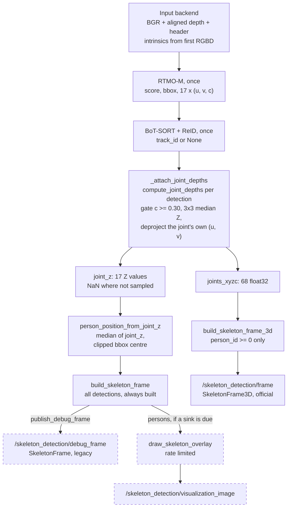
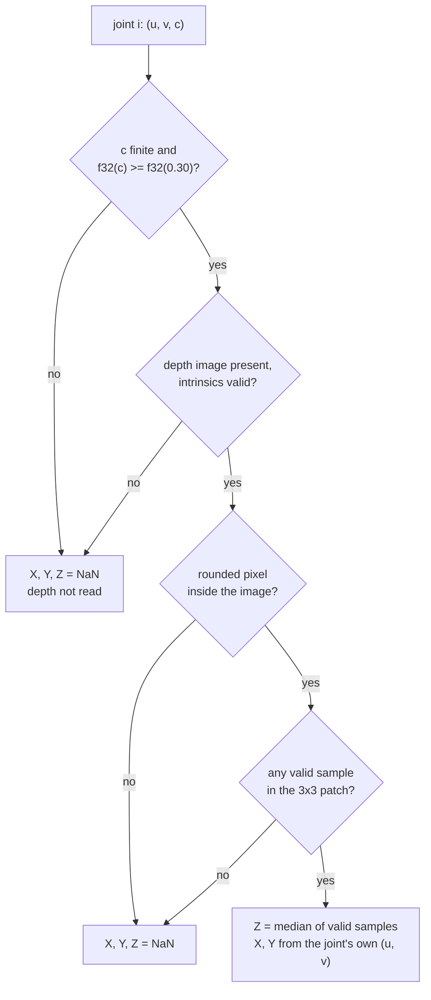

# Skeleton Detection V2.1

Technical guide to the current implementation: per-joint 3D skeletons in the
camera optical frame, built from the same single RTMO/tracking pass as V2.0.

| | |
|---|---|
| Commit | `7e1ee3d` on `feat/skeleton_detection_2.1` (V2.0 baseline: `b845fdd`) |
| Executable / node name | `iot_node` / `rtmo_node` |
| Official output | `patrolknight_msgs/msg/SkeletonFrame3D` on `/skeleton_detection/frame` |
| Also published | legacy V2.0 `SkeletonFrame` on `/skeleton_detection/debug_frame`; 2D overlay on `/skeleton_detection/visualization_image` |
| Requires | `patrolknight_msgs` with `SkeletonFrame3D` / `PersonSkeleton3D`: upstream commit `d5c82cc`, fetched by the image build ([section 7](#7-build-and-launch)) |
| Launch | `docker compose up` from the repository root, camera started through the IoT stack |

## Contents

- [What changed from V2.0](#what-changed-from-v20)
- [Inherited behaviour](#inherited-behaviour)
- [1. One frame through V2.1](#1-one-frame-through-v21)
- [2. Confidence gate and aligned-depth sampling](#2-confidence-gate-and-aligned-depth-sampling)
- [3. Topics and publication](#3-topics-and-publication)
- [4. Message schema and decoding](#4-message-schema-and-decoding)
- [5. IDs, empty frames and slot order](#5-ids-empty-frames-and-slot-order)
- [6. Coordinate frames: ROS output vs bridge JSON](#6-coordinate-frames-ros-output-vs-bridge-json)
- [7. Build and launch](#7-build-and-launch)
- [8. Configuration](#8-configuration)
- [9. Validation](#9-validation)
- [10. Troubleshooting](#10-troubleshooting)
- [11. Known limits and open items](#11-known-limits-and-open-items)

---

## What changed from V2.0

| Area | V2.0 | V2.1 |
|---|---|---|
| `/skeleton_detection/frame` | `SkeletonFrame`: UV joints, bbox, one person position | `SkeletonFrame3D`: 17 × `[X, Y, Z, c]` per person, tracked persons only |
| Legacy message | on `/skeleton_detection/frame` | unchanged, on `/skeleton_detection/debug_frame` (`publish_debug_frame`, default `true`) |
| 3D | one point per person (box centre at the person's median Z) | one point per confident joint (its own pixel at its 3 × 3 median Z); the legacy point is derived from the same samples |
| Depth sampling | `compute_person_position()` per person | `compute_joint_depths()` once per detection, shared by both messages |
| Gate comparison | score as float64 vs threshold as float64 | both in float32, so a score equal to the threshold passes |
| Untracked (`-1`) detections | published | omitted from the official message; still in the debug message |
| Deployment YAML | node default threshold | `depth_keypoint_score_threshold: 0.30` set explicitly; debug topic keys listed |
| Standalone compose | external `iot_ros-net` network, image `skeleton_humble_dev` | host network + host IPC, Fast DDS 64 MiB SHM profile; image `skeleton_detection:v2.1`, always built from the checkout (`pull_policy: build`) |
| Docker build | clones `patrolknight_msgs` `main` | fetches the pinned upstream commit `d5c82cc`; the stage can be replaced with a local checkout |

Code changes are confined to `inference/depth_estimation.py`
(`compute_joint_depths`, `person_z_from_joint_z`,
`person_position_from_joint_z`), `iot_node.py` (publishers,
`_attach_joint_depths`) and `output/message_builder.py`
(`build_skeleton_frame_3d`).

## Inherited behaviour

These stages are unchanged from V2.0 and are documented there in full:

- **Inputs.** `ros_camera` (RGBD topic from an external driver; the
  deployment default), `realsense` (camera opened in-process) or `ros_topic`
  (colour only). Each supplies BGR, optional aligned depth, a capture
  header and colour intrinsics. See
  [V2.0 §1](Skeleton_Detection_V2.0.md#1-inputs-and-launch-modes).
- **RTMO-M.** One bottom-up pass gives, per person, a score, a detector box
  (`xyxy`, unclipped) and 17 COCO joints with pixel UV and confidence;
  persons below `person_score_threshold` (0.3) are dropped. See
  [V2.0 §2](Skeleton_Detection_V2.0.md#2-rtmo-inference-and-coco-17-output).
- **Tracking.** BoxMOT 19.0.0 BoT-SORT with OSNet ReID every second frame,
  optional occlusion-aware updates; `det_ind` maps each track ID back to its
  detection; `-1` = no confirmed track this frame. See
  [V2.0 §3](Skeleton_Detection_V2.0.md#3-tracking).
- **Operations.** Image, model assets, launch file, recipes, viewer, tests and
  most troubleshooting. See
  [V2.0 §6](Skeleton_Detection_V2.0.md#6-operations).

---

## 1. One frame through V2.1

One inference and one tracking pass feed all three outputs. The branch point
is after per-joint depth sampling.



**Shared by all three outputs:** the input header (same `stamp` and
`frame_id` object), `frame_index`, the RTMO detections, the track IDs and the
depth samples. Nothing is inferred, tracked or sampled twice.

Stage by stage, as run by `RTMONode._process_frame` (`iot_node.py`):

| # | Stage | In | What the code does | Out | Missing / invalid |
|---|---|---|---|---|---|
| 1 | Input validation | driver message or camera frame | `ros_camera`: the first RGBD message fixes intrinsics from `rgb_camera_info.k`, checks depth size == colour size, maps the encoding to a scale; every message is converted with `CvBridge`; header = `rgb.header`, `frame_id` falls back to `camera_frame_id` if empty | `frame_bgr`, header, raw depth or `None` | bad `k`, size mismatch, unsupported encoding, missing fields → fatal `RGBDInputError`; a conversion error skips the frame |
| 2 | RTMO | `frame_bgr` | `RTMOInference.infer()` | `PersonDetection` list | no person → empty list; processing continues |
| 3 | Tracking | detections, frame | `SkeletonTracker.update()` (if `enable_tracking`) sets `track_id` via `det_ind` | same list | tracking off or unmatched → `track_id = None` → `person_id = -1` |
| 4 | Confidence gate | `keypoint_scores` | per joint: finite and `float32(c) >= float32(τ)` | set of joints to sample | failed gate → XYZ NaN, depth not read |
| 5 | Depth sampling | raw depth, joint UV, scale | `compute_joint_z()`: 3 × 3 patch, scale to m, reject invalid, median | `joint_z[i]` | no valid sample → NaN |
| 6 | Deprojection | joint UV, `joint_z[i]`, K | `deproject_pixel_to_point()` | `joints_xyzc[4i:4i+3]` | no Z or no valid K → NaN |
| 7 | Legacy position | `joint_z`, bbox, K | `person_position_from_joint_z()` | `detection.position` | no finite Z, empty clipped box, no K, no depth image → NaN |
| 8 | Official message | detections, packed arrays | `build_skeleton_frame_3d()`: keep `person_id >= 0`; check 68 floats | `SkeletonFrame3D` | zero tracked persons → `persons = []` |
| 9 | Publish official | — | `frame_publisher.publish()`, always | topic 1 | — |
| 10 | Legacy message | detections | `build_skeleton_frame()`, always built | `SkeletonFrame` | — |
| 11 | Publish debug | — | only if `publish_debug_frame` | topic 2 | disabled → not published, still built |
| 12 | Overlay | frame, legacy persons | `_handle_visualization()` | topic 3 and/or files | no sink due → no drawing |
| 13 | Bookkeeping | timings | `PipelineStats.record_frame()`; `frame_index += 1` | logs | — |

A depth image whose size differs from the intrinsics raises `ValueError` in
stage 5 (`_check_aligned`). The frame is then abandoned before stage 9 and
**no** output is published for it (`Frame processing failed: ...`). In
`ros_camera` mode this can only happen if the driver changes resolution after
the first message.

---

## 2. Confidence gate and aligned-depth sampling

Implemented in `compute_joint_depths()` and `compute_joint_z()` in
`skeleton_detection/inference/depth_estimation.py`.

### Symbols

| Symbol | Meaning | Unit |
|---|---|---|
| $`i \in \{0..16\}`$ | COCO joint index ([table](#joints_xyzc-layout)) | — |
| $`(u_i, v_i)`$ | joint pixel: $u$ column (right), $v$ row (down), original colour image | px |
| $`c_i`$ | RTMO joint confidence | — |
| $\tau$ | `depth_keypoint_score_threshold` | — |
| $D[r, k]$ | raw aligned depth at row $r$, column $k$; image $W \times H$ | encoding units |
| $\alpha$ | depth scale (m per unit) | m |
| $`f_x, f_y, c_x, c_y`$ | colour intrinsics from `CameraInfo.k` | px |
| $`(X_i, Y_i, Z_i)`$ | joint in the colour camera optical frame: X right, Y down, Z forward | m |

### Gate

$$
\text{sample joint } i \iff c_i \text{ is finite} \ \wedge\ \operatorname{f32}(c_i) \ge \operatorname{f32}(\tau)
$$

| Setting | Value |
|---|---|
| YAML key | `depth_keypoint_score_threshold` (in `rtmo_node.ros__parameters`) |
| Node default | `0.3` |
| `config/skeleton_detection_node.yaml` | `0.30` |
| Equality | passes: both sides are float32, the precision RTMO scores and the message carry (`test_score_exactly_at_threshold_is_sampled`) |
| Below the gate or non-finite | the depth image is **not read** for that joint (`test_no_depth_sampling_below_threshold`); XYZ = NaN; $`c_i`$ is still published |



### 3 × 3 patch and image edges

The patch is centred on the joint's rounded pixel and clipped at the border:

$$
k_i = \operatorname{round}(u_i),\quad r_i = \operatorname{round}(v_i),\qquad
P_i = \{\alpha\,D[r, k] : r \in [\max(0, r_i - 1), \min(H-1, r_i + 1)],\ k \in [\max(0, k_i - 1), \min(W-1, k_i + 1)]\}
$$

- Rounding is Python `round()`, which sends halves to the even integer
  (`u = 2.5` → column 2).
- The **centre** must lie inside the image ($`0 \le k_i < W`$,
  $`0 \le r_i < H`$); otherwise the joint is NaN. It is never clamped onto the
  edge.
- A centre on the edge keeps the in-image part: 6 samples on an edge, 4 in a
  corner (`test_corner_joint_uses_clipped_patch`).

### Invalid depth and units

Samples are converted to meters first, then filtered:

$$
S_i = \{ z \in P_i : z \text{ finite} \ \wedge\ z > 0 \ \wedge\ (z_{\min} \le 0 \vee z \ge z_{\min}) \ \wedge\ (z_{\max} \le 0 \vee z \le z_{\max}) \},
\qquad
Z_i = \operatorname{median}(S_i)
$$

$`z_{\min}, z_{\max}`$ are `depth_min_m`, `depth_max_m` (default 0 = disabled).
With $`S_i = \emptyset`$ the joint is NaN. NumPy's median of an even count is
the mean of the two middle values.

| Source | Encoding | Scale $\alpha$ | Invalid values rejected |
|---|---|---|---|
| RealSense driver (`ros_camera`) | `16UC1` | 0.001 (millimeters) | `0` = no measurement |
| ZED via `zed_adapter` (`ros_camera`) | `32FC1` | 1.0 (meters) | `NaN`, `+inf`, `-inf`, `≤ 0` |
| RealSense in-process (`realsense`) | Z16 | `depth_sensor.get_depth_scale()` | `0` |
| Any other encoding | — | refused at start-up | — |

The median rejects isolated outliers (one background pixel in the patch does
not move Z; `test_three_by_three_median_rejects_one_outlier`). It does not
fix a joint whose patch is mostly background, e.g. a wrist in front of a far
wall.

### Deprojection

The median supplies only Z. X and Y come from the joint's **own** sub-pixel
UV (not the rounded patch centre, and not the box centre):

$$
X_i = \frac{(u_i - c_x)\,Z_i}{f_x},\qquad
Y_i = \frac{(v_i - c_y)\,Z_i}{f_y},\qquad
Z_i = \operatorname{median}(S_i)
$$

$`Z_i`$ is optical-axis depth, not Euclidean distance. The model is pure
pinhole from `CameraInfo.k`; distortion `d` is ignored. The joint's
confidence is stored unchanged:

$$
\texttt{joints\_xyzc}[4i : 4i+4] = [X_i,\ Y_i,\ Z_i,\ c_i]
$$

### Reuse for the legacy person depth

`compute_joint_depths()` also returns `joint_z`, a 17-element array with
$`Z_i`$ where a joint was sampled and valid, NaN elsewhere.
`person_position_from_joint_z()` builds the legacy point from it without
reading the depth image again:

$$
Z_p = \operatorname{median}\{Z_i : Z_i \text{ finite},\ Z_i > 0\},\qquad
(u_p, v_p) = \text{centre of the bbox clipped to } [0, W] \times [0, H]
$$

$$
\texttt{position} = \left(\tfrac{(u_p - c_x) Z_p}{f_x},\ \tfrac{(v_p - c_y) Z_p}{f_y},\ Z_p\right),\qquad
\texttt{depth} = \lVert \texttt{position} \rVert_2
$$

This is the V2.0 two-stage median over the same eligible samples
(`test_legacy_position_from_joint_z_matches_original`), so the debug message
keeps its V2.0 meaning. The only change is the float32 gate comparison.

---

## 3. Topics and publication

| Topic | Type | QoS | Published when | Controls (node default / deployment YAML) |
|---|---|---|---|---|
| `/skeleton_detection/frame` | `patrolknight_msgs/msg/SkeletonFrame3D` | reliable, keep-last 10, volatile | every processed frame, including empty ones | `output_topic`; no on/off switch |
| `/skeleton_detection/debug_frame` | `patrolknight_msgs/msg/SkeletonFrame` | reliable, keep-last 10, volatile | every processed frame | `publish_debug_frame` (`true` / `true`), `debug_output_topic` |
| `/skeleton_detection/visualization_image` | `sensor_msgs/msg/Image`, `bgr8` | `visualization_reliability` (`best_effort`), keep-last 1, volatile | when due at `visualization_fps` | `publish_visualization_image` (`false` / `true`), `visualization_fps` (10.0), `visualization_width` × `_height` (424 × 240), `joint_score_threshold` (0.3), `draw_person_xyz` (`false` / `true`) |

Order within a frame: official, then debug, then overlay. All three carry the
same header and the first two the same `frame_index`, so they join exactly on
`header.stamp` (verified on recorded runs, [section 9](#9-validation)).

### Disabled outputs

| Setting | Official | Debug | Overlay |
|---|---|---|---|
| `publish_debug_frame: false` | published | not published; the `SkeletonFrame` is still built because the overlay reads it (`test_debug_disabled_keeps_official_and_overlay`) | unchanged |
| `publish_visualization_image: false` and `save_visualization_images: false` | published | published | nothing drawn |
| `enable_tracking: false` | published, **always empty** (every ID is `-1`) | all detections, ID `-1` | all detections |
| no depth (`ros_topic`, `realsense_enable_depth: false`) | tracked persons with all XYZ NaN | `position`/`depth` NaN | `Depth: N/A` |

The packaged `rtmo_node_direct_realsense.yaml` and `offline_rtmo_node.yaml`
both have tracking off, so their official topic carries only empty frames.
Enable tracking in a copy of the file to get 3D persons in those modes.

### How the viewer consumes the overlay

The overlay is drawn from the **legacy** `SkeletonFrame.persons`, as in V2.0
([V2.0 §5](Skeleton_Detection_V2.0.md#how-the-overlay-is-built)). It therefore
shows every detection including `-1` IDs, and its `Depth:` label (and the
`XYZ:` suffix with `draw_person_xyz`) is the legacy box-centre point, not the
per-joint XYZ. It is drawn at full resolution, downscaled to 424 × 240, and
published with the input header. View it with `rqt_image_view` from the IoT
`tools` container ([V2.0 §6.5](Skeleton_Detection_V2.0.md#65-viewing-the-overlay));
a reliable-QoS subscriber does not receive the default best-effort stream.

---

## 4. Message schema and decoding

Definitions as installed in `skeleton_detection:v2.1` (checked with
`ros2 interface show`):

```text
patrolknight_msgs/msg/SkeletonFrame3D
  std_msgs/Header     header        # capture stamp + optical frame_id of the input frame
  int32               frame_index   # processed-frame counter of this node run (starts at 0)
  PersonSkeleton3D[]  persons       # tracked persons only; may be empty

patrolknight_msgs/msg/PersonSkeleton3D
  int32        person_id     # BoT-SORT track ID, always >= 0 here
  float32      score         # RTMO person score
  float32[68]  joints_xyzc   # 17 COCO joints x [X, Y, Z, c], fixed size
  int32[]      connections   # 38 ints: the 19 COCO edges flattened
```

| Field | Meaning |
|---|---|
| `header.stamp` | capture time of the RGB-D frame (`ros_camera`: the driver's `rgb.header.stamp`); never the publish time |
| `header.frame_id` | the input's optical frame, e.g. `zed_left_camera_frame_optical` (ZED) or `camera_color_optical_frame` (RealSense) |
| `frame_index` | same value as the debug frame for the same input frame; resets when the node restarts |
| `person_id` | same ID as in the debug frame and the overlay |
| `score` | person confidence, not a joint confidence |
| `connections` | identical to `PersonSkeleton.connections` |

There is no bbox, person position or person depth in the official message;
use the debug topic for those.

### `joints_xyzc` layout

$$
\texttt{joints\_xyzc}[4i] = X_i,\quad [4i+1] = Y_i,\quad [4i+2] = Z_i,\quad [4i+3] = c_i,\qquad i = 0, \dots, 16
$$

| i | joint | slots | i | joint | slots | i | joint | slots |
|---|---|---|---|---|---|---|---|---|
| 0 | nose | 0–3 | 6 | right_shoulder | 24–27 | 12 | right_hip | 48–51 |
| 1 | left_eye | 4–7 | 7 | left_elbow | 28–31 | 13 | left_knee | 52–55 |
| 2 | right_eye | 8–11 | 8 | right_elbow | 32–35 | 14 | right_knee | 56–59 |
| 3 | left_ear | 12–15 | 9 | left_wrist | 36–39 | 15 | left_ankle | 60–63 |
| 4 | right_ear | 16–19 | 10 | right_wrist | 40–43 | 16 | right_ankle | 64–67 |
| 5 | left_shoulder | 20–23 | 11 | left_hip | 44–47 | | | |

Missing XYZ is `NaN, NaN, NaN`; `c` is always present. Test with
`math.isnan()` / `np.isfinite()`, never against 0.

### Decoding example

From the recorded run `experiments/zed_854x480_20261103_1812` (official and
debug messages joined on the stamp), `frame_index` 16635,
`header.frame_id = zed_left_camera_frame_optical`, person 74, score 0.978.
Intrinsics from the run's `CameraInfo`: $`f_x = 347.027`$, $`f_y = 346.756`$,
$`c_x = 438.640`$, $`c_y = 236.591`$.

| Case | Slots | Published values | Check |
|---|---|---|---|
| Joint 0, nose | `[0:4]` | `[0.48798, -0.21041, 2.63491, 0.98774]` | debug UV (502.909, 208.901): $X = (502.909 - 438.640)\cdot 2.63491 / 347.027 = 0.48798$, $Y = (208.901 - 236.591)\cdot 2.63491 / 346.756 = -0.21041$ |
| Joint 3, left_ear, missing | `[12:16]` | `[NaN, NaN, NaN, 0.13916]` | $c = 0.139 < 0.30$: gated, depth not read |
| Joint 5, left_shoulder | `[20:24]` | `[0.56062, -0.06121, 2.66232, 0.99862]` | 0.56 m right, 0.06 m up, 2.66 m in front of the camera |
| Edge 0 | `connections[0:2]` | `[15, 13]` | left_ankle (slots 60–63) to left_knee (slots 52–55) |

```python
import numpy as np
j = np.asarray(person.joints_xyzc, dtype=np.float32).reshape(17, 4)   # row i = joint i
xyz, conf = j[:, :3], j[:, 3]
valid = np.isfinite(xyz).all(axis=1)
edges = np.asarray(person.connections).reshape(-1, 2)                 # 19 x (a, b)
```

---

## 5. IDs, empty frames and slot order

| Case | Official `SkeletonFrame3D` | Debug `SkeletonFrame` |
|---|---|---|
| Detection with `person_id = -1` (tracking off, unconfirmed or unmatched track) | **omitted** (`test_negative_ids_omitted_from_official_only`) | included with `-1` |
| Tracked person, no joint has valid XYZ | **kept**: all 17 XYZ NaN, confidences present (`test_tracked_person_without_any_xyz_is_kept`) | included, `position`/`depth` NaN |
| No tracked person in the frame | published with `persons = []`, capture stamp and `frame_index` (`test_empty_official_frame_keeps_capture_stamp`) | published, possibly with `-1` persons |
| Joint slots | always 17 in COCO order; slot $i$ is joint $i$ even when NaN; never compacted or reordered | 51 floats, same order |
| Array length ≠ 68 | `build_person_skeleton_3d` raises `ValueError` (programming error, not data) | — |

An empty official frame means "processed, nobody tracked", which is different
from a missing frame. Detection-only consumers should read the debug topic.
A track can be `-1` on a person's first frame and then keep its ID; the
earlier frame is not back-filled.

---

## 6. Coordinate frames: ROS output vs bridge JSON

| | ROS `/skeleton_detection/frame` (this node) | Zenoh JSON (the IoT `zenoh_bridge`) |
|---|---|---|
| Owner | `skeleton_detection` | `zenoh_bridge`, not this repo |
| Frame | colour camera **optical** frame named in `header.frame_id` | map/world frame |
| Axes | X right, Y down, Z forward along the optical axis | world x, y |
| Units | meters (`float32`) | meters |
| Transform | none: no TF, no extrinsics, no robot pose | camera extrinsic offset (from bridge config) + live device pose |
| Missing value | `NaN` | `null` |

This node never transforms points out of the camera frame. Moving them to
the map frame, and writing missing values as `null`, are bridge
responsibilities.

**Current bridge state (verified in the checked-out IoT sources).** The
bridge at the IoT submodule commit `987e631` (`skeleton_relay_component.cpp`)
subscribes to the **legacy** `SkeletonFrame` on the hard-coded topic
`/skeleton_detection/frame`. It transforms only the person `position`
($`x_b = Z`$, $`y_b = -X`$, then offset and device pose) and publishes
`devices/{device_id}/skeleton` with `position: [world_x, world_y]`; NaN is
serialized as `null` by the JSON library. In V2.1 that topic carries
`SkeletonFrame3D`, so this bridge version receives nothing from a V2.1 node.
No source in the workspace consumes `SkeletonFrame3D` or defines a per-joint
map-frame JSON. Until the bridge is updated, treat the V2.1 JSON contract as
**not implemented**.

---

## 7. Build and launch

### Default: `docker compose up`

From the repository root of a fresh checkout:

```bash
docker compose up            # add -d to detach; stop with Ctrl+C or `docker compose down`
```

That one command builds the image from this checkout and starts the node with
`config/skeleton_detection_node.yaml` (`ros_camera` input, tracking + ReID,
overlay on). It needs no pre-built image, no environment variable and no
sibling checkout. Start the camera separately through the IoT stack so it
publishes `/camera/camera/rgbd`, e.g. the ZED only:

```bash
cd ../iot
docker compose -f docker/docker-compose.yml --project-directory . --profile zed up -d zed
```

Host requirements: Docker Engine with Compose v2+, the NVIDIA Container
Toolkit, and network access for the first build (Ubuntu/pip packages, the
two checkpoints, and `patrolknight_msgs` from GitHub). The first build takes
a long time; later runs reuse the build cache.

Expected log (ZED at its current setting):

```text
RTMO-M loaded in ...s on <CUDA device name>
ReID loaded in ...s
BoT-SORT ready (ReID every 2 frames, occlusion-aware (experimental))
Input: /camera/camera/rgbd (ros_camera)
Output: /skeleton_detection/frame (SkeletonFrame3D), debug /skeleton_detection/debug_frame (SkeletonFrame), visualization /skeleton_detection/visualization_image @ 10.0 Hz
First RGBD frame: 854x480, depth 32FC1 aligned
```

Until the camera publishes, the log stops after the `Output:` line. With a
RealSense driver the last line reads e.g. `848x480, depth 16UC1 aligned`. The
config is bind-mounted; edit it and restart the container to apply.

### What the defaults are

| `compose.yaml` setting | Value | Why |
|---|---|---|
| `build` | context `.`, `docker/Dockerfile` | the image always comes from this checkout |
| `image` | `skeleton_detection:v2.1` | a V2.1-specific tag; older local tags such as `skeleton_humble_dev` are never used |
| `pull_policy` | `build` | every `up` runs the (cached) build, so a pulled code change cannot silently run an old image |
| `network_mode`, `ipc` | `host`, `host` | same DDS graph and shared memory as the IoT containers |
| `RMW_IMPLEMENTATION` | `rmw_fastrtps_cpp` | match the IoT containers |
| `FASTRTPS_DEFAULT_PROFILES_FILE` | `/config/fastdds.xml` (mounted `docker/fastdds.xml`) | SHM transport with 64 MiB segments + UDPv4, builtin transports off; identical to `iot/config/dds/fastdds.xml`. A multi-MB RGBD message does not fit Fast DDS's default segment and, best-effort, never arrives |
| `ROS_DOMAIN_ID` | `${ROS_DOMAIN_ID:-0}` | read from the shell; use the same value as the IoT stack |

### Messages: `patrolknight_msgs`

`iot_node.py` imports `SkeletonFrame` and `SkeletonFrame3D` at module load,
so the image must contain the V2.1 message types. They are merged upstream:
`patrol-knight/patrolknight_msgs` commit `d5c82cc` ("add
msg/PersonSkeleton3D.msg and msg/SkeletonFrame3D.msg", current `main`). Its
definitions are identical to the ones V2.1 was developed and tested against.

The first Dockerfile stage fetches exactly that commit
(`ARG PATROLKNIGHT_MSGS_REF=d5c82cc7f68048f04626c866c309055f2e25b92d`) from
the public HTTPS URL; no GitHub credentials are needed. A SHA is used instead
of `main` because Docker caches the fetch layer by its instruction text: with
a branch name, a machine that built before the merge would keep reusing the
old, legacy-only messages. To move to newer messages, bump the SHA (or pass
`--build-arg PATROLKNIGHT_MSGS_REF=<sha|branch|tag>`).

To test unmerged message changes from a local checkout, replace the stage
with a named build context and use a separate tag:

```bash
docker build -f docker/Dockerfile \
  --build-context patrolknight_msgs=../patrolknight_msgs \
  -t skeleton_detection:msgs-local .
```

Verify the installed type:

```bash
docker run --rm skeleton_detection:v2.1 \
  ros2 interface show patrolknight_msgs/msg/PersonSkeleton3D
# expect: int32 person_id / float32 score / float32[68] joints_xyzc / int32[] connections
```

### IoT submodule launch (V2.0 today)

`iot/docker/docker-compose.yml` has its own `skeleton` service (container
`iot-skeleton-1`, image `iot-skeleton`), built from `modules/skeleton_detection`.
That submodule is pinned to `b845fdd`, i.e. **V2.0**: it publishes the legacy
`SkeletonFrame` on `/skeleton_detection/frame` and has no debug topic. It
uses `iot/config/skeleton_detection.yaml`, not this repo's config.

`./launch.sh up` starts `zed`, `zenoh_bridge` and `skeleton` by default.

### Avoiding the wrong image and duplicate publishers

Run exactly one skeleton service.

| Situation | Result | Do |
|---|---|---|
| IoT `skeleton` and standalone `skeleton_humble` both up | two publishers on `/skeleton_detection/frame` with **different types** | stop one: `docker compose -f docker/docker-compose.yml --project-directory . stop skeleton` (IoT repo), or start the stack with `./launch.sh up skeleton:=false` |
| An older image (`skeleton_humble_dev`, a hand-built tag) | not used: Compose builds and runs `skeleton_detection:v2.1` | run other tags only with `docker run`, never under the `skeleton_humble` name while the service is up |
| `zenoh_bridge` running next to V2.1 | bridge subscribes the legacy type on the same topic and gets nothing | expected until the bridge is updated ([section 6](#6-coordinate-frames-ros-output-vs-bridge-json)) |

Check what is running and who publishes:

```bash
docker ps --format '{{.Names}}  {{.Image}}'
docker exec skeleton_humble bash -lc \
  'ros2 topic info /skeleton_detection/frame --verbose --no-daemon'
# expect: Type: patrolknight_msgs/msg/SkeletonFrame3D, Publisher count: 1, node rtmo_node
```

---

## 8. Configuration

Only the V2.1-relevant keys; the full list is in
[V2.0 §6.6](Skeleton_Detection_V2.0.md#66-parameter-reference).

| Key | Type | Node default | `skeleton_detection_node.yaml` | Effect |
|---|---|---|---|---|
| `output_topic` | string | `/skeleton_detection/frame` | same | official `SkeletonFrame3D` |
| `publish_debug_frame` | bool | `true` | `true` | legacy `SkeletonFrame` |
| `debug_output_topic` | string | `/skeleton_detection/debug_frame` | same | |
| `depth_keypoint_score_threshold` | double | 0.3 | 0.30 | gate τ |
| `depth_min_m`, `depth_max_m` | double | 0.0 | — | optional bounds; ≤ 0 disables |
| `enable_tracking` | bool | `false` | `true` | the official topic needs it |
| `with_reid`, `occlusion_aware_tracking` | bool | `true`, `false` | `true`, `true` | |
| `publish_visualization_image` | bool | `false` | `true` | |
| `draw_person_xyz` | bool | `false` | `true` | appends the legacy XYZ to overlay labels |
| `camera_frame_id` | string | `camera_color_optical_frame` | — | `header.frame_id` in `realsense` mode; fallback when the driver's is empty |

Not ROS parameters: the 3 × 3 window (`DepthParams.window`), the depth scale
(from encoding or device) and the ReID interval (2).

---

## 9. Validation

### Automated tests

No camera or GPU needed:

```bash
docker run --rm -v "$PWD":/src:ro -w /src skeleton_detection:v2.1 \
  python3 -m pytest -p no:anyio -p no:cacheprovider -q test/
```

Result on 2026-11-04 with the `skeleton_detection:v2.1` image built by
`docker compose build --no-cache`: **172 passed** (also 172 on the earlier
`v2.1-local` image).

### Default build and launch (2026-11-04)

Checked on the DGX Spark from a copy of the working tree containing only the
files git tracks (no `data/`, `experiments/`, weights or sibling checkout),
with no `SKELETON_IMAGE` set and without using the existing
`skeleton_detection:v2.1-local` image:

| Check | Result |
|---|---|
| `docker compose build --no-cache` | built `skeleton_detection:v2.1` in 4 min 5 s; only the local `ros:humble-ros-base` base image was reused; `patrolknight_msgs` fetched at `d5c82cc` over anonymous HTTPS; both checkpoints sha256 OK; `IMAGE VERIFICATION PASSED` |
| Installed types | `SkeletonFrame`, `PersonSkeleton`, `SkeletonFrame3D`, `PersonSkeleton3D`; `PersonSkeleton3D.joints_xyzc` is `float32[68]`; `iot_node` imports |
| `docker compose up` | rebuilt from cache, started `skeleton_humble` on `skeleton_detection:v2.1`, logged the expected start-up lines up to `Output: ...` |
| Input | the camera was **not** started; the recorded ZED bag `experiments/zed_854x480_static_20261103_1821/input_rgbd` was replayed on `/camera/camera/rgbd` from the IoT `tools` image (host network/IPC, same Fast DDS profile, same `ROS_DOMAIN_ID`) |
| First frame | `First RGBD frame: 854x480, depth 32FC1 aligned` |
| `/skeleton_detection/frame` | type `SkeletonFrame3D`, 1 publisher (`rtmo_node`), 29.7 Hz; sample frame: 1 tracked person, 68 floats, 16 of 17 joints with finite XYZ, `frame_id = zed_left_camera_frame_optical` |
| `/skeleton_detection/debug_frame` | type `SkeletonFrame`, 1 publisher |
| Node stats | `skeleton_fps` 28–30, `vis_fps` 10.0, `rtmo_ms` ≈19, `track_ms` ≈3.5 |

Not covered: a live camera started through the IoT stack, and a machine with
an empty Docker cache for the base image.

| File | Covers |
|---|---|
| `test/test_joint_xyz.py` | gate below/equal/above; no depth read below the gate; non-finite scores; pinhole XYZ at the joint's own pixel; 3 × 3 median with an outlier; corner and last-pixel patches; outside-image joints; invalid patches; range bounds; missing depth/intrinsics; misaligned depth; `16UC1` and `32FC1`; legacy position equals the V2.0 result |
| `test/test_skeleton_frame_3d.py` | field order; 68 floats; confidences; negative IDs; tracked person without XYZ; empty frames; one inference and one tracking call per frame; debug and overlay inputs; debug disabled; YAML threshold and override |
| `test/test_skeleton_frame_stamp.py` | capture stamp and `frame_id` pass-through, fallback `frame_id`, `frame_index` |
| others (`test_reid_interval.py`, `test_occlusion_tracking.py`, `test_person_depth.py`, ...) | inherited V2.0 behaviour |

### Recorded live runs

Two runs from 2026-11-03 are in the git-ignored `experiments/` directory
(input RGBD bag, official and debug JSONL exports, overlay video, figures).
The numbers below were recomputed from those files for this guide; the
plotting script is not in the repository. No experiment was rerun.

| | |
|---|---|
| Compute | NVIDIA GB10 (DGX Spark), `aarch64`, driver 580.173.02 |
| Camera path | ZED through the IoT `zed` service and `zed_adapter` (`grab_resolution: HD720`, `grab_frame_rate: 30`, `pub_downscale_factor: 1.499`); ZED model not recorded |
| Delivered stream (read from the bag, every message) | RGB 854 × 480 `bgr8`; depth 854 × 480 `32FC1`; RGB and depth stamps identical; $`f_x = 347.03`$, $`f_y = 346.76`$, $`c_x = 438.64`$, $`c_y = 236.59`$; `frame_id = zed_left_camera_frame_optical` |
| Node | `skeleton_detection:v2.1-local`, deployment YAML (tracking + ReID + occlusion-aware, τ = 0.30) |

**Throughput** (run `zed_854x480_20261103_1812`, 1 to 3 people). The input
bag holds 1359 RGBD messages at a stamp rate of 29.78 Hz. The node published
1342 official frames over 45.0 s of capture stamps, i.e. 29.80 Hz, with
consecutive `frame_index` values; the run's figure gives 29.82 Hz for both
input and output on one receiver. This shows the node kept up with a 30 Hz
input. It does not measure maximum processing rate.

**Output consistency** (same run).

| Check | Result |
|---|---|
| Official and debug frames joined on `header.stamp` | 1341 pairs (one official frame outside the debug recording window), `frame_index` equal in all |
| Joint confidences, official vs debug | identical |
| Joints below the gate with XYZ | 0 |
| Gated joints with NaN XYZ (no valid sample in the patch) | 30 of 28,659 |
| Debug persons with `-1` (omitted from official) | 189 |
| Pinhole check from debug UV + `CameraInfo` | matches the published X, Y (example in [section 4](#decoding-example)) |

The run's figure also reports an independent recompute from the bag depth
for the static run: 12,519 finite joints, max |difference| 4.77 × 10⁻⁷ m,
0 of 12,614 NaN-pattern mismatches. The counts match the JSONL (12,614 joint
slots, 95 NaN); the bag-level recompute itself was not repeated here.

**Repeatability** (run `zed_854x480_static_20261103_1821`, one person
standing still, `person_id` 101 throughout, window 5–20 s after the first
RGBD message, 447 frames, 100 % valid for both joints):

| Joint | Median position (m) | Std about median X / Y / Z (cm) | P95 frame-to-frame step X / Y / Z (cm) |
|---|---|---|---|
| left_shoulder | (0.437, −0.066, 2.605) | 0.40 / 0.16 / 1.28 | 0.31 / 0.25 / 1.79 |
| left_wrist | (0.907, 0.101, 2.557) | 1.00 / 0.47 / 1.98 | 1.24 / 0.23 / 3.10 |

The figure in that run directory reports the same quantities from 448 frames,
within 0.1 cm. Z noise dominates, and the wrist is noisier than the shoulder.

**Absolute accuracy** was not measured: there is no ground truth in these
runs. The numbers above are throughput and repeatability only, for this
camera, resolution and distance (≈2.6 m).

### Live check procedure

1. Preflight the input: `ros2 topic hz /camera/camera/rgbd`; the first-frame
   log line shows the delivered size and encoding.
2. `ros2 topic info /skeleton_detection/frame --verbose --no-daemon`: one
   publisher, type `SkeletonFrame3D`.
3. Compare input and output rates on the same receiver.
4. Record the RGBD input plus the official and debug topics; join on
   `header.stamp`; recompute selected joints from the bag depth, debug UVs and
   `CameraInfo`. They should match to float32 precision. Keep run outputs in
   `experiments/<run>/`, not in tracked docs.

---

## 10. Troubleshooting

V2.0's [troubleshooting tables](Skeleton_Detection_V2.0.md#69-troubleshooting)
still apply. V2.1-specific symptoms:

| Symptom | Cause | Fix |
|---|---|---|
| `ImportError: cannot import name 'SkeletonFrame3D'` at start-up | image built from messages without the V2.1 types (an old `main` cached by a branch-name build, or a hand-built tag) | `docker compose up` with the pinned SHA rebuilds correctly; check with `ros2 interface show` |
| Build fails in the `patrolknight_msgs_git` stage (`git fetch`) | no network to GitHub, or `PATROLKNIGHT_MSGS_REF` names a commit/branch that does not exist | restore network; use a full 40-character SHA, a branch or a tag |
| Build fails downloading checkpoints or packages | first build needs network access | rerun when online; later builds are cached |
| `docker compose up` prints a build every time | `pull_policy: build`; unchanged layers come from cache | expected; use `docker compose up --no-build` only if you know the image is current |
| `Conflict. The container name "/skeleton_humble" is already in use` | a container of that name from an older image or `docker run` | `docker rm -f skeleton_humble`, then `docker compose up` |
| `CUDA is not available inside this container` | NVIDIA Container Toolkit missing or not configured | install/configure it; the service reserves all GPUs |
| Log stops after `Output: ...`, no `First RGBD frame` | camera not started, wrong `ROS_DOMAIN_ID`, or the RGBD topic is not reaching this container | start the camera via the IoT stack; same `ROS_DOMAIN_ID` in both shells; `ros2 topic hz /camera/camera/rgbd` inside the container |
| Official frames always have `persons: []` | tracking off (direct and offline configs), or nobody confirmed yet | `enable_tracking: true`; use the debug topic for raw detections |
| All XYZ NaN, confidences present | no depth (`ros_topic`), every joint below τ, or depth invalid around joints | use a depth input; check the `First RGBD frame` line; lower τ only if confidences are genuinely low |
| A joint's Z jumps to the background | patch mostly off the body (thin limbs, edges) | expected limitation of a 3 × 3 median; filter downstream by confidence and temporal consistency |
| Two publishers / two types on `/skeleton_detection/frame` | IoT `skeleton` (V2.0) and standalone V2.1 both running | [section 7](#avoiding-the-wrong-image-and-duplicate-publishers) |
| Bridge publishes no skeleton JSON | bridge expects the legacy type on this topic | [section 6](#6-coordinate-frames-ros-output-vs-bridge-json) |
| RGBD topic listed but `First RGBD frame` never logged | SHM profile not loaded | check `FASTRTPS_DEFAULT_PROFILES_FILE` is readable (a parse error prints `XMLPARSER Error`) and `ipc: host` |
| `ros2 topic info` inside `skeleton_humble` fails with `unknown tag 'rclpy.type_hash.TypeHash'` | a Jazzy-started ros2 daemon (ZED container) on the shared host network | add `--no-daemon`; `sequence size exceeds remaining buffer` lines are harmless Humble/Jazzy discovery noise |
| `First RGBD frame: 848x480` expected but `854x480` logged | ZED publishes 854 × 480 at the current `pub_downscale_factor` | expected |

---

## 11. Known limits and open items

- **Message pin.** The image fetches `patrolknight_msgs` at `d5c82cc`; later
  message changes need the SHA bumped in `docker/Dockerfile`.
- **IoT stack still on V2.0.** The submodule pin, `iot/config/skeleton_detection.yaml`
  and the bridge all target the legacy message on `/skeleton_detection/frame`.
- **No V2.1 map-frame JSON** in any checked-out bridge source.
- **Depth model.** Pinhole, distortion ignored; a 3 × 3 median per joint;
  no temporal filtering; no TF. Joints are not checked for anatomical
  consistency.
- **Tracking-gated output.** Persons appear only once confirmed; with a 30 Hz
  input and the default `tracking_frame_rate` (55), lost tracks live ≈5.5 s
  rather than the nominal 3 s.
- **Validation scope.** One camera (ZED, 854 × 480), one host, short runs,
  repeatability only; absolute accuracy unmeasured.
