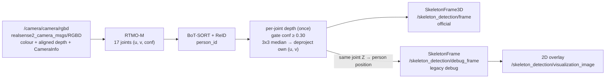

# Skeleton Detection V2.1 — per-joint camera-frame XYZ

V2.1 adds an official 3D skeleton output. RTMO and tracking still run
**once per frame**; three outputs are built from that one result.

## Pipeline



## Outputs

| Topic | Type | Content | Switch |
|---|---|---|---|
| `/skeleton_detection/frame` | `patrolknight_msgs/msg/SkeletonFrame3D` | tracked persons, per-joint XYZ + confidence | `output_topic` |
| `/skeleton_detection/debug_frame` | `patrolknight_msgs/msg/SkeletonFrame` | V2.0 message: UV joints, bbox, person position/depth, all IDs | `publish_debug_frame`, `debug_output_topic` |
| `/skeleton_detection/visualization_image` | `sensor_msgs/msg/Image` | unchanged 2D overlay | `publish_visualization_image`, `visualization_fps`, ... |

All three carry the input frame's `header` (capture `stamp`, optical
`frame_id`) and the same `frame_index`, so they can be joined on
`header.stamp`.

## ROS types

```text
SkeletonFrame3D                         PersonSkeleton3D
  std_msgs/Header    header               int32       person_id
  int32              frame_index          float32     score
  PersonSkeleton3D[] persons              float32[68] joints_xyzc
                                          int32[]     connections
```

- `header.stamp`: capture time of the RGB-D frame, never the publish time.
- `persons` may be empty; an empty frame is still published every frame.
- `person_id`: only tracked persons (`>= 0`). Untracked (`-1`) detections
  are omitted here but stay in the debug frame. A tracked person whose joints
  all lack XYZ is still published.
- `connections`: same 19 COCO edges as V2.0 (38 ints, indices 0–16).
- No bbox, person position or person depth in the official message.

## `joints_xyzc` layout

17 COCO joints in the standard order, 4 floats each:

```text
[X0, Y0, Z0, c0,  X1, Y1, Z1, c1,  ...,  X16, Y16, Z16, c16]    # 68 floats
joint i -> elements 4*i .. 4*i+3
```

| Index | Joint | Index | Joint | Index | Joint |
|---|---|---|---|---|---|
| 0 | nose | 6 | right_shoulder | 12 | right_hip |
| 1 | left_eye | 7 | left_elbow | 13 | left_knee |
| 2 | right_eye | 8 | right_elbow | 14 | right_knee |
| 3 | left_ear | 9 | left_wrist | 15 | left_ankle |
| 4 | right_ear | 10 | right_wrist | 16 | right_ankle |
| 5 | left_shoulder | 11 | left_hip | | |

- `X, Y, Z`: meters, camera **optical** frame (`header.frame_id`): X right,
  Y down, Z forward.
- `c`: the original RTMO joint confidence, always present.

## Depth gate and XYZ

Per joint, with `depth_keypoint_score_threshold` (default `0.30`, set in
`config/skeleton_detection_node.yaml`):

| Joint confidence | Depth sampled? | Result |
|---|---|---|
| `< threshold` or non-finite | no | `[NaN, NaN, NaN, c]` |
| `>= threshold` (equal counts) | yes | see below |

For a sampled joint at pixel `(u, v)`:

1. Take the 3×3 aligned-depth patch centred on `(round(u), round(v))`,
   clipped at the image border.
2. Scale to meters (`16UC1` × 0.001, `32FC1` × 1), drop zero / NaN / ±inf
   and samples outside `depth_min_m` / `depth_max_m` (when > 0).
3. `Z` = median of the remaining samples. None left → `[NaN, NaN, NaN, c]`.
4. `X = (u − cx)·Z / fx`, `Y = (v − cy)·Z / fy`, with `K` from the RGB
   `CameraInfo` (pinhole, distortion ignored), using the joint's **own** UV.

- Pixels outside the image, missing depth or missing intrinsics → NaN XYZ.
- The comparison runs in float32, so a score equal to the threshold passes.
- The legacy person position reuses these joint Z values, so no patch is
  sampled twice.

## Missing values

- ROS: `NaN` in X, Y, Z; the slot and its confidence are always kept.
- JSON (bridge / exports): `NaN` becomes `null`; confidence is kept. That
  conversion belongs to the bridge, not to this node.

## Running

The camera is **owned by the IoT stack** (ZED + RGB-D adapter, or
realsense2_camera). This repo only runs the skeleton service; never run the
IoT `skeleton` service and this one at the same time (both publish
`/skeleton_detection/frame`).

```bash
# image with the local patrolknight_msgs (until the V2.1 messages are pushed)
docker build -f docker/Dockerfile \
  --build-context patrolknight_msgs=../patrolknight_msgs \
  -t skeleton_detection:v2.1-local .

SKELETON_IMAGE=skeleton_detection:v2.1-local docker compose up --no-build
```

## Validation procedure

Automated (inside the image, no camera):

```bash
docker run --rm -v "$PWD":/src:ro -w /src skeleton_detection:v2.1-local \
  python3 -m pytest -p no:anyio -p no:cacheprovider -q test/
```

| Test file | Covers |
|---|---|
| `test/test_joint_xyz.py` | gate below/equal/above, no sampling below the gate, pinhole XYZ, 3×3 median with outlier, borders, invalid depth, 16UC1 / 32FC1 |
| `test/test_skeleton_frame_3d.py` | message fields and order, 68 floats, confidences, negative IDs, empty frames, one pass per frame, debug/overlay, YAML threshold |
| `test/test_skeleton_frame_stamp.py` | capture stamp, `frame_id`, `frame_index` on both frames |

Live (with the camera running):

1. Preflight `/camera/camera/rgbd`: RGB and aligned depth have the expected
   size, both `CameraInfo` match it, RGB and depth share a stamp.
2. `ros2 topic info /skeleton_detection/frame --verbose`: exactly one
   publisher, type `SkeletonFrame3D`.
3. Measure input and output rates on the same receiver
   (`ros2 topic hz` gives a quick check).
4. Record the RGB-D input as a bag plus the official and debug topics; join
   them on `header.stamp` and recompute selected joints from the bag depth,
   debug UVs and `CameraInfo`. Values should match the official output to
   float32 precision.

Results and run files stay in the git-ignored `experiments/` directory, not
in tracked docs.
